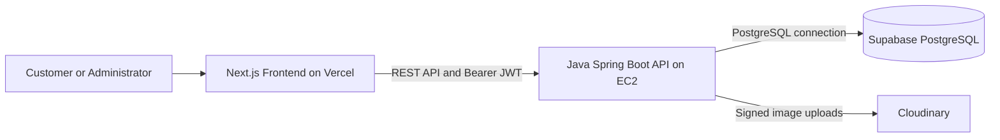

<div align="center">


# NCWU StyleHub

### An online clothing store built for university systems development practice

A full-stack online clothing store combining a responsive storefront, administration tools, a Java REST API, and a PostgreSQL database.


[Project Context](#project-context) · [Features](#features) · [Getting Started](#getting-started) · [Deployment](#deployment) · [Environment Variables](#environment-variables)

</div>

---

## Project Context

| Academic detail | Description |
| --- | --- |
| University | North China University of Water Resources and Electric Power (NCWU) |
| School | School of Information Engineering |
| Course | Comprehensive Design of Computer Systems |
| Design project | Comprehensive Internship in Computer System Development 2 |
| Application | NCWU StyleHub — Online Clothes Store |

This academic project applies systems development concepts to an online clothing store: a customer-facing shopping experience, role-based administration, REST API integration, and persistent data storage.

**This repository contains the Next.js frontend.** The Java Spring Boot backend and database configuration are maintained separately. Running this frontend alone does not start the API or database.

## Features

### Customer Storefront

- Browse homepage banners, product categories, featured products, and promotions.
- Search the catalog, filter by category, and sort products.
- View product images, details, available sizes, and reviews.
- Manage a shopping cart, wishlist, and checkout shipping details.
- Place orders, view order history, inspect order details, and request cancellation where allowed.
- Register, sign in, manage an account, and use password recovery flows.
- Submit product reviews and contact messages; access shipping information and FAQs.

### Administration

- View dashboard statistics and analytics.
- Create and edit products, manage stock, and upload product images.
- Manage users, orders, and review moderation.
- Review contact messages and newsletter subscriptions.
- Adjust browser-local appearance preferences.

### Assignment Coverage

| Development requirement | Implemented area |
| --- | --- |
| Product uploading and management | Admin product editor, image uploads, and catalog controls |
| User management | Admin user management and customer authentication |
| Product review management | Customer review submission and admin moderation |
| Product display | Homepage, searchable shop, and product details |
| Shopping cart | Size-aware cart items, quantity controls, and checkout |
| Order management | Order placement, customer order history, and admin status management |

## Architecture



The frontend calls the backend under `/api/v1`. The Java backend handles authentication, business rules, database access, and signed Cloudinary uploads. Supabase supplies PostgreSQL; this frontend does not connect directly to Supabase or use Supabase Auth.

The intended deployment keeps the frontend on Vercel and runs the Java API behind Nginx on AWS EC2. Cloudinary is optional; backend local upload storage is the fallback and requires persistent storage on the server.

## Technology

| Layer | Technology |
| --- | --- |
| Frontend | Next.js 16 App Router and React 19 |
| Language | TypeScript 5 |
| Styling | Tailwind CSS 4 |
| Icons | Lucide React |
| Backend, maintained separately | Java 21, Spring Boot, Maven |
| Database | Supabase-hosted PostgreSQL |
| Authentication | Backend-issued JWT bearer tokens |
| Image storage | Backend-signed Cloudinary uploads or persistent local uploads |

Exact frontend dependency versions are declared in [`package.json`](package.json).

## Backend

The backend is implemented with **Java 21, Spring Boot, Maven, and Spring Data JPA**. It exposes REST endpoints under `/api/v1` and provides:

- Registration, sign-in, JWT issuance, and role-based access for customers and administrators.
- Product and category retrieval, product administration, stock management, and image uploads.
- Order creation, order history, cancellation, and administrative status updates.
- Review submission and moderation, wishlist operations, contact messages, and newsletter subscriptions.
- Database persistence, request validation, password hashing, and API rate limiting.
- Signed Cloudinary uploads, with local upload storage as a fallback.

Backend source lives in `java-backend/` in the full project workspace, outside this frontend Git repository. With Java 21 and Maven installed, run these commands **from that backend directory**:

```bash
mvn spring-boot:run
```

To build and run the packaged API:

```bash
mvn package -DskipTests
java -jar target/stylehub-api-1.0.0.jar
```

The default API port is `8080`. Set backend environment variables in the process or hosting platform. Without `DATABASE_URL`, the backend uses a local H2 file database; deployed instances should use the configured Supabase PostgreSQL database.

## Database

**Supabase hosts the PostgreSQL database.** Database access is performed by the Java backend through JDBC and JPA. Authentication uses the application's own user records and JWT implementation.

The full project's `supabase/schema.sql` defines these areas:

| Data area | Tables | Purpose |
| --- | --- | --- |
| Accounts | `users` | Customer and administrator records, roles, and password hashes |
| Catalog | `categories`, `products`, `product_images` | Product classification, descriptions, stock, and image references |
| Reviews | `reviews` | Product feedback and moderation |
| Shopping | `cart_items`, `wishlists` | Schema support for cart records and saved products; the current frontend cart is browser-local |
| Orders | `orders`, `order_items` | Order headers and purchased product lines |
| Store content | `banners`, `promotions` | Homepage and promotional content |
| Communication | `subscribers`, `contact_messages` | Newsletter subscriptions and customer inquiries |

Configure the backend with the PostgreSQL connection details supplied by Supabase. The production deployment template uses the **Session pooler on port 5432** with SSL and separate database credentials. The backend currently uses Hibernate schema auto-update; back up existing data before deployment and review schema changes before applying them.

The schema file and backend configuration are part of the full project workspace and are not included in this frontend repository.

## Full Project Organization

The development workspace separates the application into these parts:

```text
Online store web app/
  frontend/       Next.js storefront and admin UI; this GitHub repository
  java-backend/   Java Spring Boot REST API and Maven configuration
  supabase/       PostgreSQL schema
  deploy/aws/     EC2 Docker Compose, Nginx, HTTPS, and environment templates
```

The AWS package targets a **2 GB RAM EC2 instance** with only Java and Nginx running on the server. The frontend remains on Vercel and the database remains on Supabase. It includes a 512 MB Java heap, a 1 GB API container memory limit, persistent upload storage, health checks, restart policies, and log rotation. These are deployment settings, not a claim of tested production capacity.

## Getting Started

### Prerequisites

- Node.js 20.9 or newer; a supported LTS release is recommended.
- npm.
- A running, compatible Java backend. Its default local address is `http://localhost:8080`.

### Install and Run

```bash
git clone https://github.com/miltonbabu/ncwu-stylehub-frontend.git
cd ncwu-stylehub-frontend
npm install
```

Create `.env.local` in the repository root:

```dotenv
NEXT_PUBLIC_API_URL=http://localhost:8080
```

Start the development server:

```bash
npm run dev
```

Open [localhost:3000](http://localhost:3000). Backend-dependent features need a reachable API and database. Restart the development server after changing environment variables.

### Available Commands

| Command | Purpose |
| --- | --- |
| `npm run dev` | Start the development server |
| `npm run build` | Build the production frontend |
| `npm start` | Serve the production build |
| `npm run lint` | Run ESLint |

## Environment Variables

### Frontend — Vercel

| Variable | Example | Purpose |
| --- | --- | --- |
| `NEXT_PUBLIC_API_URL` | `https://api.example.com` | Public Java backend base URL |

Use the backend base URL **without `/api/v1` or a trailing slash**. The API client adds the route prefix. If unset, it defaults to `http://localhost:8080`, which is intended for local development.

**Cloudinary credentials are not needed in Vercel.** The frontend sends image files to the authenticated Java upload endpoint; the backend signs the Cloudinary request and returns the image URL.

Do not place a database password, JWT signing secret, Cloudinary API secret, or Supabase privileged key in a `NEXT_PUBLIC_` variable. These values are exposed to the browser when used in frontend code. This frontend also does not need `NEXT_PUBLIC_SUPABASE_URL` or a Supabase public key in its current architecture.

### Backend — EC2 or Another Java Host

These belong on the backend host, not in this frontend's Vercel settings:

| Variable | Purpose |
| --- | --- |
| `DATABASE_URL` | Supabase PostgreSQL connection URL |
| `DATABASE_USER`, `DATABASE_PASSWORD` | Separate database credentials, when used |
| `SECRET_KEY` | Strong, stable JWT signing secret |
| `CORS_ORIGINS` | Exact allowed frontend origins, comma separated |
| `CLOUDINARY_CLOUD_NAME` | Optional Cloudinary cloud name |
| `CLOUDINARY_API_KEY` | Optional Cloudinary upload API key |
| `CLOUDINARY_API_SECRET` | Optional Cloudinary signing secret |
| `CLOUDINARY_FOLDER` | Optional image folder |

Email recovery and notification flows also require the backend's email provider configuration. Follow the backend deployment guide for the complete environment reference.

## Deployment

### Vercel Frontend

1. Import this repository into Vercel and select the Next.js framework preset.
2. Keep the root directory at the repository root.
3. Add `NEXT_PUBLIC_API_URL` with your deployed backend's HTTPS URL.
4. Select the appropriate Production and Preview environments.
5. Deploy. Redeploy after changing the public API variable because it is included in the frontend build.

### Backend Connection

- Deploy the Java API separately and configure its Supabase database connection.
- Enable HTTPS for the API; an HTTPS storefront cannot call an HTTP API in the browser.
- Set backend `CORS_ORIGINS` to the exact Vercel or custom frontend origin, without a trailing slash.
- Configure Cloudinary on the backend if cloud image uploads are required.
- Verify product loading, authentication, order placement, and image uploads after deployment.

## Repository Structure

```text
public/                   Static assets and branding
src/
  app/                    App Router pages and layouts
    admin/                Administration pages
    auth/                 Sign-in, registration, and password recovery
    cart/                 Shopping cart
    checkout/             Checkout and order confirmation
    help/                 Contact, FAQ, and policy pages
    orders/               Customer order history and details
    product/              Product details
    shop/                 Product catalog
    wishlist/             Saved products
  components/             Shared storefront and admin interface components
  lib/                    API client, auth/cart state, types, and utilities
package.json              Dependencies and npm scripts
vercel.json               Vercel build configuration
```

## Academic Demo Notes

- Payment choices are demonstrations. The checkout creates orders; it does not process real payments or charge customers.
- Cart data and appearance preferences use browser-local storage. Authentication state is also stored in the browser.
- Password recovery and email notifications depend on a configured backend email provider.
- Some social links use coming-soon placeholders.
- Demo accounts depend on backend configuration. Production deployments should disable demo seeding and replace or disable known demo credentials.

This repository documents an educational implementation. Deployment readiness and performance depend on the backend configuration, hosting resources, and validation in the target environment.

---

<div align="center">

**NCWU StyleHub**

Comprehensive Internship in Computer System Development 2

North China University of Water Resources and Electric Power

</div>
