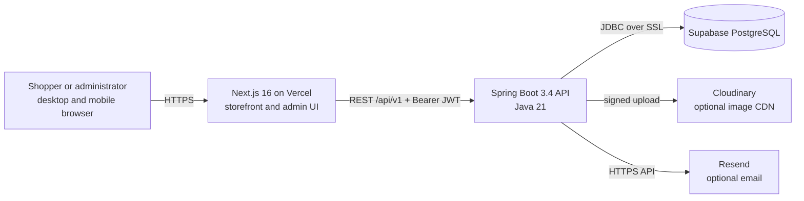
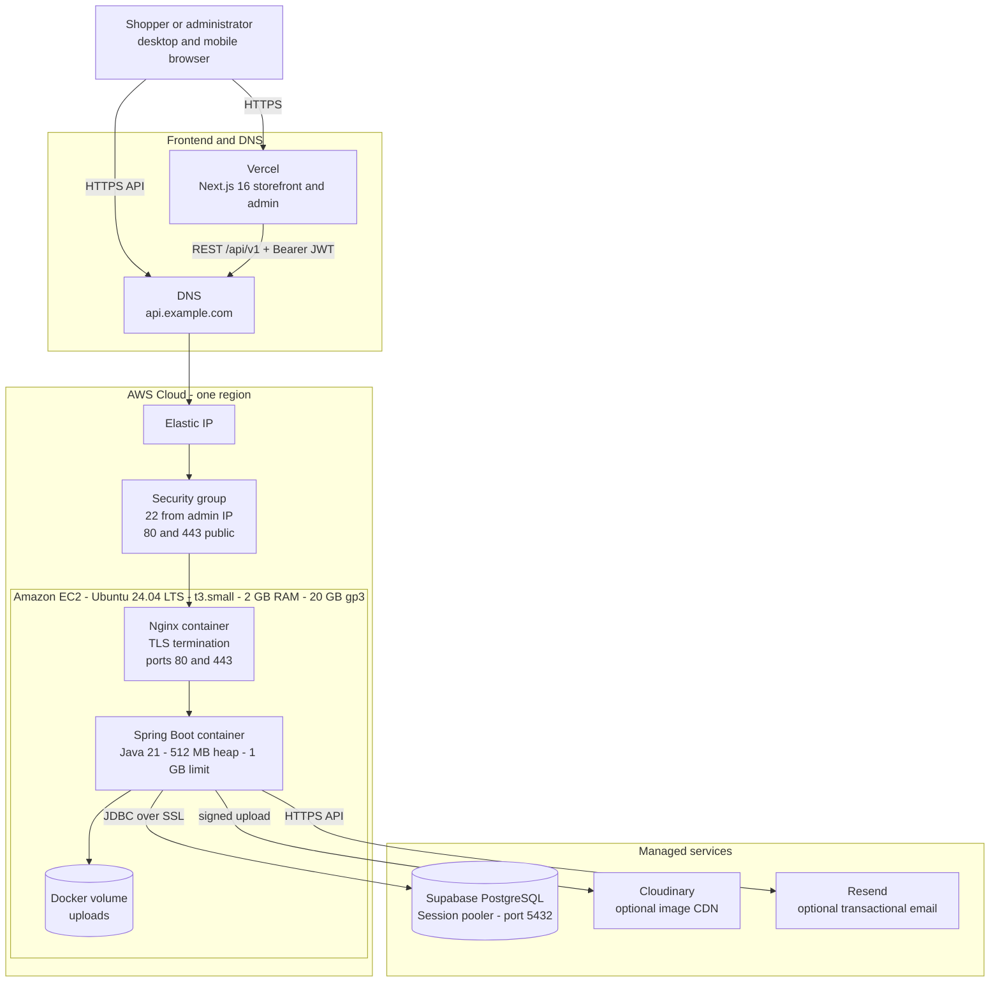
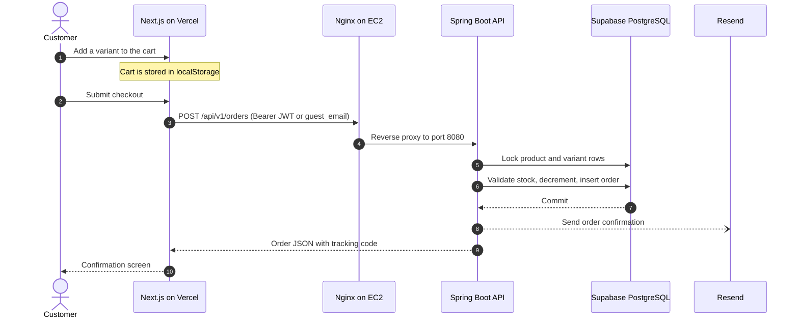
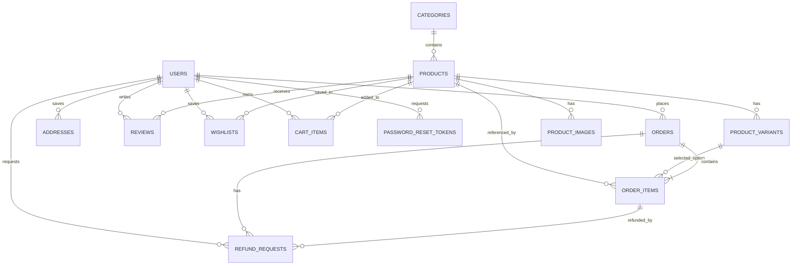

<div align="center">


# NCWU StyleHub

### A complete online clothing store with a Java API, PostgreSQL, and an AWS deployment path

<p>
  <strong>Read this in:</strong>
  &nbsp;
  <kbd>English</kbd>
  &nbsp;·&nbsp;
  <a href="README.zh-CN.md"><kbd>简体中文</kbd></a>
</p>

A full-stack e-commerce application built for the course design **Comprehensive Internship in Computer System Development 2** at North China University of Water Resources and Electric Power, School of Information Engineering.

The project combines a responsive Next.js storefront, a role-based administration panel, a Java Spring Boot REST API, a PostgreSQL database, and a production-style single-server deployment on AWS EC2.

> **Live app:** [https://shop.ncwu.site](https://shop.ncwu.site) — sign in with the **Quick demo access** buttons for a customer or read-only admin session, or register a new account.

[Overview](#overview) · [Features](#features) · [Architecture](#architecture) · [Quick start](#quick-start-run-locally-in-5-minutes) · [AWS deployment](#deploy-the-api-to-aws) · [UI/UX design](#uiux-design-system) · [API](#api-reference) · [Troubleshooting](#troubleshooting)


</div>

---

## Overview

NCWU StyleHub is a working online clothing store, not a UI mockup. A shopper can browse a seeded catalog, choose a style and size, add items to a cart, check out, track an order, cancel it before shipment, request a refund after shipment, save favourites, and leave a moderated review. An administrator can manage products and variants, upload images, manage users, moderate reviews, update order status and tracking, decide refunds, read contact messages, manage club members, and review sales and profit analytics.

The project is intentionally small enough to run on one 2 GB EC2 instance while still using a realistic architecture: a separately hosted frontend, a stateless Java API, a managed PostgreSQL database, optional Cloudinary image storage, and optional Resend transactional email.

> **Project status:** functional course project. Payments are simulated, not processed. The deployment is production-style but not a high-availability or load-tested commercial system. See [Limitations](#limitations-and-next-steps).

> **Repository layout:** on GitHub, the Next.js app is at the repository root (`src/`, `public/`, `package.json`). The course development workspace used during the project keeps the same app under `frontend/`. Commands below use the GitHub layout. If your checkout uses the workspace layout, run frontend commands from `frontend/` instead.

---

## Features

### Storefront

| Area | What works |
| --- | --- |
| Home page | Auto-playing hero carousel, category showcase, featured products, promotional banners, new arrivals, trust section, club sign-up |
| Catalog | Search, category filters, price-range filter (min/max), size filter, sorting by newest, price ascending, price descending, and rating; responsive product grid with loading skeletons and empty states |
| Product detail | Image gallery, style and size variants, per-variant price and stock, live stock badge (In stock / Only N left / Sold out), discount badges, quantity selector, wishlist, share action, "You may also like" cross-sell block, review list and review form |
| Cart | Variant-aware cart stored in `localStorage`, quantity controls capped by available stock, subtotal, free-shipping threshold at ¥80, flat ¥6.90 shipping below the threshold |
| Checkout | Guest checkout or signed-in checkout, shipping name, address and phone, saved-address picker, Alipay, WeChat Pay, or cash-on-delivery selection, order summary, confirmation screen with tracking code |
| Orders | Order history, order detail, visual tracking timeline, tracking number, cancellation before shipment, refund request after shipment, refund status |
| Guest tracking | Public order lookup by order number plus the email used at checkout, no account required |
| Account | Profile summary, order shortcuts, address book (add, edit, delete, set default), tracking codes with copy action, saved items, admin panel link for administrators |
| Authentication | Registration, sign-in, sign-out, forgot password, reset password, 60-minute single-use reset links |
| Wishlist | Saved products backed by the API, not only browser storage |
| Support pages | Contact form, FAQ, shipping and returns, privacy, terms |
| Club | Newsletter subscription with a welcome email when email is configured |

### Administration

| Area | What works |
| --- | --- |
| Dashboard | Revenue, gross profit, order count, average order value, 7, 30, or 90 day range, sales and profit chart, top products, order status breakdown, low-stock and pending-review counts |
| Products | Create, edit, delete, feature, hide, stock management, style and size variants, image upload by file |
| Orders | Search by order number or customer, update status, set tracking number, permanently delete an order |
| Refunds | Review customer requests, approve or reject with an optional note, email the decision when email is configured |
| Reviews | Approve, reject, or delete submitted reviews |
| Users | Create customers or administrators, change roles, enable or disable accounts, delete accounts |
| Club | View and remove newsletter subscribers |
| Messages | Read the contact inbox, mark messages as read, delete messages |
| Appearance | Switch between eight storefront and admin colour themes; the choice is saved in the browser |
| Demo admin | A separate read-only role that can view the dashboard, products, reviews, and appearance without changing data |

### Platform behaviour

- JWT bearer authentication with HS256 signing, PBKDF2-HMAC-SHA256 password hashing, and customer, admin, and read-only demo-admin roles.
- Per-IP sliding-window rate limits: 10 requests per minute for login and registration, 20 per minute for image uploads, 300 per minute for the rest of the API.
- Database-backed health endpoint at `/health`.
- H2 file database fallback so local development needs no database server.
- Optional Cloudinary uploads with a local `uploads/` fallback.
- Optional Resend email for welcome, order, tracking, cancellation, password reset, refund, club, and contact notifications.
- Docker Compose, Nginx, HTTPS, persistent uploads, memory limits, restart policies, and log rotation for the EC2 deployment.

---

## Architecture

### System context



The frontend never connects directly to PostgreSQL and never holds a database password, JWT signing secret, Cloudinary secret, or Resend API key. All privileged work happens in the Java API.

### AWS deployment topology



### AWS services used

| Service | Role in this project | Configuration |
| --- | --- | --- |
| Amazon EC2 | Runs the Java API and Nginx | Ubuntu 24.04 LTS, `t3.small` starting size, 2 GB RAM, 20 GB gp3 root volume |
| Amazon EBS | EC2 root disk | gp3, encrypted recommended, snapshot or backup before upgrades |
| Elastic IP | Stable public IPv4 for DNS | Associate with the instance; release it if the instance is removed |
| Security group | Network boundary | SSH 22 from your IP only, HTTP 80 and HTTPS 443 from the internet, no public 8080 or 5432 |
| Route 53 (optional) | DNS for `api.example.com` | Any registrar works; create an A record pointing to the Elastic IP |
| CloudWatch (optional) | Monitoring and alarms | Not configured by default; add CPU, status-check, and disk alarms for production |

> **AWS scope:** this project uses AWS for the API compute layer only. The frontend is on Vercel, the database is on Supabase, and images are optionally on Cloudinary. It does not use S3, CloudFront, RDS, an Application Load Balancer, Auto Scaling, ECS, EKS, or Lambda. That is deliberate: one small EC2 instance keeps the course deployment affordable and understandable. The trade-off is a single point of failure and no automatic scaling.

### Checkout and order flow



Order totals, stock changes, and shipping are calculated on the server. The browser cart is a convenience layer; it is not trusted for prices or stock. Checkout accepts a JWT for signed-in customers or a `guest_email` for guests; guests can later look up the order with the order number and that email.

---

## Technology

| Layer | Technology | Version or notes |
| --- | --- | --- |
| Frontend | Next.js App Router | 16.4.6 |
| UI runtime | React and React DOM | 19.3.0 |
| Language | TypeScript | 5.x |
| Styling | Tailwind CSS | 4.3.3, CSS custom properties, `@theme inline` |
| Icons | Lucide React | SVG icons, no emoji icons |
| Backend | Java | 21 |
| Backend framework | Spring Boot, Spring Web, Spring Data JPA, Validation | 3.4.5 |
| Build | Maven | 3.9+ |
| Database | PostgreSQL via Supabase | H2 file database for local development |
| Authentication | JWT HS256, PBKDF2-HMAC-SHA256 | 24-hour token lifetime by default |
| Media | Cloudinary or local uploads | Backend-signed uploads |
| Email | Resend | Optional; fire-and-forget |
| Frontend hosting | Vercel | Next.js preset |
| Backend hosting | AWS EC2, Docker Compose, Nginx, Certbot | Single instance |
| Testing | JUnit 5 and Spring Boot Test | One backend security test class with four cases |

---

## Repository layout

```text
.
├── src/                         Next.js App Router source
│   ├── app/                     Storefront, auth, account, orders, help, admin
│   ├── components/              Shared storefront, admin, and UI components
│   └── lib/                     API client, auth and cart state, themes, types, utilities
├── public/                      Brand marks and static assets
├── java-backend/                Spring Boot REST API
│   ├── src/main/java/           Controllers, services, domain, security, seed data
│   ├── src/test/java/           Backend tests
│   ├── Dockerfile               Multi-stage Java 21 image
│   └── pom.xml                  Maven build
├── deploy/aws/                  EC2 Docker Compose, Nginx, HTTPS, environment template
├── supabase/                    schema.sql, seed.sql, and incremental migrations
├── package.json                 Frontend dependencies and scripts
├── next.config.ts               Next.js configuration
├── vercel.json                  Vercel build configuration
├── README.md                    English README
└── README.zh-CN.md              Simplified Chinese README
```

In the course workspace, `frontend/` contains the `src/`, `public/`, `package.json`, and Next.js configuration shown above. The backend, deployment kit, and database files stay at the workspace root.

---

## Quick start: run locally in 5 minutes

This path needs no cloud account, no Supabase project, and no Docker. The backend uses an H2 file database and seeds a demo catalog automatically.

### Prerequisites

| Tool | Minimum | Recommended | Check |
| --- | --- | --- | --- |
| Git | 2.30 | Current | `git --version` |
| Node.js | 20.9 | 22 LTS | `node --version` |
| npm | 10 | Current with Node | `npm --version` |
| JDK | 21 | Eclipse Temurin 21 | `java -version` |
| Maven | 3.9 | Current 3.9.x | `mvn --version` |
| Docker | 24 | Current with Compose v2 | `docker --version` (optional) |

Optional accounts: Supabase for PostgreSQL, Cloudinary for image CDN, Resend for email, and AWS for the EC2 deployment.

### 1. Clone the repository

```bash
git clone https://github.com/miltonbabu/ncwu-stylehub.git
cd ncwu-stylehub
```

### 2. Start the API

Open a terminal in the backend directory:

```bash
cd java-backend
mvn spring-boot:run
```

The API starts on `http://localhost:8080`. On first start it creates `java-backend/data/stylehub.mv.db`, creates the schema, and seeds categories, products, variants, banners, promotions, reviews, a demo customer, and a read-only demo admin.

Verify it:

```bash
curl http://localhost:8080/health
```

Expected response:

```json
{"status":"ok"}
```

Useful local behaviour:

- No `DATABASE_URL` means H2, not PostgreSQL.
- `APP_DEMO_ENABLED` defaults to `true`, so demo catalog and demo customer data are seeded.
- `APP_DEMO_ADMIN_ENABLED` defaults to `true`, so the read-only demo admin is created.
- If `SECRET_KEY` is not set, the API generates a random signing key on every boot. Existing tokens stop working after a restart. Set a stable `SECRET_KEY` locally if that is annoying.

### 3. Start the storefront

Open a second terminal in the directory that contains `package.json` (the repository root on GitHub, or `frontend/` in the course workspace):

```bash
npm ci
```

Create `.env.local` in that same directory:

```dotenv
NEXT_PUBLIC_API_URL=http://localhost:8080
```

Start the development server:

```bash
npm run dev
```

Open [http://localhost:3000](http://localhost:3000). The API must be running for products, authentication, orders, and admin pages to work. Restart the frontend after changing `NEXT_PUBLIC_API_URL` because it is embedded at build time.

### 4. Sign in

The sign-in page includes **Quick demo access** buttons that fill these credentials for you.

| Role | Email | Password | Access |
| --- | --- | --- | --- |
| Customer | `user@shop.ncwu.site` | `demo@123` | Storefront, cart, checkout, orders, wishlist, reviews |
| Demo admin | `demo-admin@shop.ncwu.site` | `demo-admin@123` | Read-only dashboard, products, reviews, appearance |
| Full admin, Supabase seed only | `admin@shop.ncwu.site` | `admin@123` | Full back office; change this password immediately |
| Full admin, local H2 | none by default | none | Promote a registered account, see below |

> **Important:** the backend does not create a full administrator in the local H2 database. This is intentional. The demo admin is read-only. To manage products, users, orders, and refunds locally, promote your own account using the steps in [Create a full administrator](#create-a-full-administrator).

### 5. Smoke test

- [ ] Home page loads the hero carousel, categories, featured products, and promotions.
- [ ] Shop search, category filter, and sort controls work.
- [ ] Product detail shows style and size options and updates stock and price.
- [ ] Add to cart, open the cart, and complete checkout as the demo customer.
- [ ] The order appears under **My Orders** with a tracking code and timeline.
- [ ] Sign in as the demo admin and confirm the dashboard loads without edit controls.
- [ ] `GET /health` returns `{"status":"ok"}`.

---

## Create a full administrator

### Option A: Supabase SQL editor

Register a normal account through `/auth/sign-up`, then run this in the Supabase SQL editor:

```sql
UPDATE users
SET role = 'admin'
WHERE email = 'you@example.com';
```

Sign out and sign in again. The role is carried in the JWT, so the old token keeps the old role until it expires or you sign in again.

### Option B: Local H2 database

1. Stop the API with `Ctrl+C` so the H2 file is not locked.
2. Open the H2 file with your preferred SQL client, for example DBeaver or IntelliJ Database:
   - JDBC URL: `jdbc:h2:file:C:/Online store web app/java-backend/data/stylehub`
   - User: `sa`
   - Password: empty
3. Run the same `UPDATE users SET role = 'admin' WHERE email = 'you@example.com';` statement.
4. Restart `mvn spring-boot:run` and sign in again.

An H2 Shell invocation looks like this. Replace the H2 jar path with the version in your Maven repository:

```bash
java -cp "<path-to-h2.jar>" org.h2.tools.Shell \
  -url "jdbc:h2:file:./data/stylehub" \
  -user sa \
  -password "" \
  -sql "UPDATE users SET role='admin' WHERE email='you@example.com';"
```

### Option C: Fresh Supabase database with the demo seed

If you run `supabase/seed.sql` on a fresh database, it creates a full administrator:

```text
Email:    admin@shop.ncwu.site
Password: admin@123
```

Change that password immediately, or create your own account and promote it. Do not keep known demo credentials on a public deployment.

### Disable demo accounts in production

Set both of these on the backend host:

```dotenv
APP_DEMO_ENABLED=false
APP_DEMO_ADMIN_ENABLED=false
```

The first stops demo catalog and demo customer seeding. The second stops the read-only demo admin from being recreated. The EC2 Compose file already defaults both to `false`; verify your `.env` if you override them.

---

## Configuration reference

### Frontend

| Variable | Required | Example | Notes |
| --- | --- | --- | --- |
| `NEXT_PUBLIC_API_URL` | Yes in production | `https://api.example.com` | Backend base URL only. No trailing slash. Do not append `/api/v1`. Embedded at build time, so redeploy after changing it. If unset, the client falls back to `http://localhost:8080`. |

Do not put database passwords, JWT secrets, Cloudinary API secrets, Resend API keys, or Supabase service-role keys in any `NEXT_PUBLIC_*` variable. Everything with that prefix is visible to the browser.

### Backend

| Variable | Required | Default | Purpose |
| --- | --- | --- | --- |
| `DATABASE_URL` | Production | empty, uses H2 | PostgreSQL connection URL. Accepts `postgresql://` or `postgres://`. Include `?sslmode=require` for Supabase. Read from the OS environment. |
| `DATABASE_USER` | With Supabase | parsed from URL, else `postgres` | Supabase pooler user, usually `postgres.PROJECT_REF`. Read from the OS environment. |
| `DATABASE_PASSWORD` | With Supabase | empty | Database password. Use a dedicated credential. Read from the OS environment. |
| `SECRET_KEY` | Production | random per boot | JWT signing secret. Use at least 32 random characters. A stable value keeps tokens valid across restarts. |
| `ACCESS_TOKEN_EXPIRE_MINUTES` | No | `1440` | Token lifetime in minutes, 24 hours by default. |
| `CORS_ORIGINS` | Production | `http://localhost:3000,http://127.0.0.1:3000` | Exact allowed frontend origins, comma separated, no spaces, no trailing slash. Read from the OS environment. |
| `SERVER_PORT` | No | `8080` | API listen port. |
| `APP_DEMO_ENABLED` | No | `true` | Seeds demo catalog and demo customer. Set `false` in production. |
| `APP_DEMO_ADMIN_ENABLED` | No | `true` | Creates the read-only demo admin. Set `false` in production. |
| `DEMO_ADMIN_EMAIL` | No | `demo-admin@shop.ncwu.site` | Demo admin email, only used when demo admin is enabled. |
| `DEMO_ADMIN_PASSWORD` | No | `demo-admin@123` | Demo admin password, only used when demo admin is enabled. |
| `CLOUDINARY_CLOUD_NAME` | No | empty | Cloudinary cloud name. |
| `CLOUDINARY_API_KEY` | No | empty | Cloudinary API key. |
| `CLOUDINARY_API_SECRET` | No | empty | Cloudinary API secret. Backend only. |
| `CLOUDINARY_FOLDER` | No | `ncwu-stylehub` | Cloudinary upload folder. |
| `RESEND_API_KEY` | No | empty | Enables transactional email when set. |
| `MAIL_FROM` | No | `NCWU StyleHub <info@shop.ncwu.site>` | Sender address. Must be verified in Resend. |
| `SITE_URL` | No | `https://shop.ncwu.site` | Public frontend URL used in email links. No trailing slash. |
| `ADMIN_EMAIL` | No | `md.milton@qq.com` | Inbox for contact messages and refund alerts. |

### Where settings are read from

The backend has two configuration paths, and this trips people up:

- `SECRET_KEY`, `ACCESS_TOKEN_EXPIRE_MINUTES`, demo flags, Cloudinary, Resend, `MAIL_FROM`, `SITE_URL`, and `ADMIN_EMAIL` are read through the backend `Env` helper, which checks OS environment variables first and then `java-backend/.env`.
- `DATABASE_URL`, `DATABASE_USER`, `DATABASE_PASSWORD`, and `CORS_ORIGINS` are read directly from OS environment variables by the datasource and web configuration.

For local runs, export the database and CORS values in your shell:

**PowerShell**

```powershell
$env:DATABASE_URL = "postgresql://aws-0-REGION.pooler.supabase.com:5432/postgres?sslmode=require"
$env:DATABASE_USER = "postgres.PROJECT_REF"
$env:DATABASE_PASSWORD = "your-database-password"
$env:SECRET_KEY = "a-long-random-secret"
$env:CORS_ORIGINS = "http://localhost:3000"
cd java-backend
mvn spring-boot:run
```

**macOS or Linux**

```bash
export DATABASE_URL="postgresql://aws-0-REGION.pooler.supabase.com:5432/postgres?sslmode=require"
export DATABASE_USER="postgres.PROJECT_REF"
export DATABASE_PASSWORD="your-database-password"
export SECRET_KEY="a-long-random-secret"
export CORS_ORIGINS="http://localhost:3000"
cd java-backend
mvn spring-boot:run
```

Docker Compose passes all of these explicitly, so the EC2 deployment does not depend on shell exports.

### Secret rules

- Never commit `.env`, `.env.local`, database passwords, JWT secrets, Cloudinary secrets, or Resend keys.
- Generate the JWT secret with `openssl rand -hex 32` or an equivalent password manager.
- Use Supabase **Session pooler** credentials on port `5432`, not the public database password in a frontend variable.
- The frontend needs only `NEXT_PUBLIC_API_URL`. Cloudinary and Resend belong on the backend.
- Rotate or disable all demo accounts before a public launch.
- JWT and user data are stored in browser `localStorage`. This is simple and common for a course project, but any XSS becomes token theft. Add a strict Content Security Policy and avoid untrusted HTML if you harden the app.

---

## Database

### Fresh Supabase project

1. Create a project at [supabase.com](https://supabase.com).
2. Open **SQL Editor** and run [`supabase/schema.sql`](supabase/schema.sql).
3. Run the migrations in [`supabase/migrations/`](supabase/migrations) in filename order. They are guarded with `IF NOT EXISTS` and add features that the base schema may not include, such as password reset tokens.
4. Optional: run [`supabase/seed.sql`](supabase/seed.sql) once to load the demo catalog, demo customer, and the full demo administrator. Never rerun it on a live database.
5. Open **Connect** and copy the **Session pooler** connection string on port `5432`.
6. Set `DATABASE_URL`, `DATABASE_USER`, and `DATABASE_PASSWORD` on the backend.
7. Start the API and check `/health`.

### Existing database

Back up the database first, then apply the migrations in order:

| Order | Migration | Adds |
| --- | --- | --- |
| 1 | `20261115-club-and-order-updates.sql` | Club subscribers, order `updated_at` |
| 2 | `20261115-cost-profit-password-reset.sql` | Product cost, order-line cost, password reset tokens |
| 3 | `20261115-sizes-wishlist-tracking.sql` | Product sizes, cart and order size, tracking numbers, wishlists |
| 4 | `20261116-contact-messages.sql` | Contact inbox |
| 5 | `20261121-product-variants-refunds.sql` | Product variants, variant inventory, refund requests, backfill for existing sized products |
| 6 | `20261125-more-products.sql` | Twelve additional catalog products across every category, matched by slug so it is safe to re-run |
| 7 | `20261128-address-book-guest-checkout.sql` | Address book table, `orders.guest_email`, nullable `orders.user_id` for guest checkout |

Do not rerun `seed.sql` on a live database. It inserts fixed IDs and demo users, and it will conflict with real data.

Hibernate runs with `ddl-auto=update`, so it can also add missing columns. Treat the SQL schema and migrations as the controlled path, and use Hibernate's update only as a development convenience.

### Schema overview



| Table | Purpose |
| --- | --- |
| `users` | Customers, administrators, read-only demo administrators, password hashes, active flag |
| `categories` | Catalog categories and display order |
| `products` | Product details, price, compare-at price, cost, stock, sizes, featured and active flags |
| `product_variants` | Style and size combinations with their own price, cost, stock, and image |
| `product_images` | Additional product gallery images |
| `reviews` | Ratings and comments with pending, approved, or rejected status |
| `cart_items` | Server-side cart model; the current storefront cart is browser-local |
| `wishlists` | Saved products per user |
| `addresses` | Saved shipping addresses per user, with a single default per customer |
| `orders` | Order header, status, total, shipping details, payment method, tracking number, timestamps, guest email for account-less orders |
| `order_items` | Purchased lines with saved name, price, cost, style, size, and variant reference |
| `refund_requests` | Refund quantity, reason, status, admin note, request and resolution timestamps |
| `banners` | Homepage hero slides |
| `promotions` | Homepage promotional blocks |
| `subscribers` | NCWU StyleHub Club members |
| `contact_messages` | Contact form inbox and read flag |
| `password_reset_tokens` | Hashed, single-use, 60-minute reset tokens |

### Local H2

- File: `java-backend/data/stylehub.mv.db`
- User: `sa`, empty password
- Reset everything: stop the API, delete `java-backend/data/` and `java-backend/uploads/`, restart. The database and demo catalog are recreated.
- H2 is for local development only. Use PostgreSQL for anything shared or public.

### Backups

- Supabase: enable scheduled backups or take a manual backup before migrations.
- Docker uploads: back up the `uploads` volume, or use Cloudinary so images live outside the instance.
- EC2: snapshot the root volume before OS or Docker upgrades.
- Test a restore, not just a backup.

---

## Media uploads

Administrators upload product images through `POST /api/v1/admin/products/{id}/images`.

| Behaviour | Detail |
| --- | --- |
| Maximum size | 5 MB per image, 10 MB maximum request |
| Allowed types | `.png`, `.jpg`, `.jpeg`, `.webp`, `.gif` |
| Rate limit | 20 uploads per minute per IP |
| Cloudinary configured | The backend signs the upload and stores the returned `secure_url` |
| Cloudinary not configured | The file is saved under `uploads/` and served at `/uploads/<file>` |
| Docker deployment | The `uploads` named volume persists files across container recreation |
| Frontend | Requests Cloudinary images with `f_auto,q_auto` and appropriate dimensions |

Cloudinary is recommended for production because local uploads are tied to one EC2 instance and its volume. The Cloudinary secret must be set on the backend, never on Vercel.

---

## Email

Email is optional. Without `RESEND_API_KEY`, the backend logs a warning and skips sending; sign-up, checkout, cancellation, refunds, and password reset requests still work.

When enabled, Resend sends:

- Welcome email after registration.
- Order confirmation with items and tracking code.
- Order status and tracking updates.
- Order cancellation confirmation.
- Password reset link, valid for 60 minutes and single use.
- Refund request alert to `ADMIN_EMAIL`.
- Refund decision to the customer.
- Club welcome email.
- Contact form message to `ADMIN_EMAIL`, with the sender as reply-to.

`MAIL_FROM` must use a sender or domain verified in Resend. `SITE_URL` controls the links inside emails, so set it to your public frontend URL without a trailing slash.

---

## Build, test, and quality checks

| Task | Command | Notes |
| --- | --- | --- |
| Backend tests | `cd java-backend && mvn test` | Runs the Spring Boot test suite |
| Backend package | `cd java-backend && mvn package -DskipTests` | Produces `target/stylehub-api-1.0.0.jar` |
| Run packaged API | `java -jar target/stylehub-api-1.0.0.jar` | Run from `java-backend/` |
| Frontend lint | `npm run lint` | ESLint with the Next.js configuration. The current tree has pre-existing `react-hooks/set-state-in-effect` findings and image warnings, so treat the production build as the release gate and fix lint findings in files you change. |
| Frontend production build | `npm run build` | Verifies the Next.js production bundle; this is the frontend release gate |
| Frontend production serve | `npm start` | Serves the build on port 3000 |
| Backend Docker image | `docker build -t stylehub-api ./java-backend` | Multi-stage Java 21 build |

There is currently no frontend unit test suite and no end-to-end test suite. `npm run build` is the frontend build gate, and the manual smoke test above is the functional release check. If you extend the project, add Playwright or Cypress coverage for sign-in, checkout, and admin moderation first.

### Manual QA checklist

- [ ] Sign up, sign in, sign out, and reset a password with email configured.
- [ ] Search and filter the catalog by category, price range, and size, then open a product with multiple styles and sizes.
- [ ] Confirm the stock badge shows "In stock", "Only N left" for five or fewer, and "Sold out" at zero.
- [ ] Confirm the product page shows a "You may also like" block.
- [ ] Add a variant to the cart, change quantity, remove it, and add it again.
- [ ] Check out below and above the ¥80 free-shipping threshold.
- [ ] Check out as a guest without signing in, then look the order up on `/track` with the order number and email.
- [ ] Save an address in the account address book, then pick it at checkout and confirm the fields fill in.
- [ ] Cancel a pending order and confirm stock is restored.
- [ ] As an admin, set an order to shipped, add a tracking number, and confirm the customer timeline.
- [ ] Request a refund as the customer, approve it as the admin, and confirm both emails.
- [ ] Submit a review, then approve or reject it in the admin panel.
- [ ] Upload a product image and confirm it appears on the storefront.
- [ ] Switch themes and refresh; the choice should persist.
- [ ] Check 375 px, 768 px, 1024 px, and 1440 px widths for layout breaks.

---

## Deploy the API to AWS

The detailed, copy-paste deployment guide lives in [`deploy/aws/README.md`](deploy/aws/README.md). The summary below is enough to understand the shape of the deployment; follow the detailed guide for the actual commands and Certbot hooks.

### Before you start

- An AWS account with permission to create EC2, EBS, Elastic IP, and security group resources.
- A Supabase project with the schema and migrations applied.
- A domain or subdomain for the API, for example `api.example.com`.
- A Vercel account for the frontend.
- Optional Cloudinary and Resend accounts.

AWS pricing and free-tier eligibility depend on your account, Region, and usage. A `t3.small` is a starting size for light traffic, not a guaranteed free-tier instance. Check current pricing before launching.

### 1. Launch the instance

- Ubuntu 24.04 LTS.
- `t3.small` or similar 2 GB instance.
- At least 20 GB gp3 storage.
- Elastic IP associated with the instance.
- Inbound TCP 22 from your IP, TCP 80 and 443 from the internet.
- Do not expose 8080 or 5432.

### 2. Install the runtime

```bash
sudo apt-get update
sudo apt-get install -y docker.io docker-compose-v2 git certbot
sudo systemctl enable --now docker
sudo usermod -aG docker "$USER"
```

Log out and back in before running Docker without `sudo`. On a 2 GB instance, add 2 GB of swap if the build runs out of memory. Swap helps builds; it does not replace RAM.

### 3. Configure the backend

```bash
git clone https://github.com/miltonbabu/ncwu-stylehub.git stylehub
cd stylehub/deploy/aws
cp .env.example .env
chmod 600 .env
openssl rand -hex 32
nano .env
```

Fill in:

- `DATABASE_URL`: Supabase Session pooler URL on port `5432`, with `?sslmode=require`.
- `DATABASE_USER`: pooler user, usually `postgres.PROJECT_REF`.
- `DATABASE_PASSWORD`: database password.
- `SECRET_KEY`: the value from `openssl rand -hex 32`.
- `CORS_ORIGINS`: exact frontend origin, no trailing slash, no wildcard.
- `SITE_URL`: public frontend URL.
- `ADMIN_EMAIL`: inbox for contact and refund alerts.
- `RESEND_API_KEY` and `MAIL_FROM` if you want email.
- Cloudinary values if you want CDN uploads.
- `APP_DEMO_ENABLED=false` and `APP_DEMO_ADMIN_ENABLED=false` for production.

Quote values containing `$` or `#` in the Compose `.env` file.

### 4. Build and start

```bash
docker compose config --quiet
docker compose build api
docker compose up -d
docker compose ps
docker compose logs --tail=100 api
curl --fail http://localhost/health
```

The API container has a 512 MB Java heap and a 1 GB container limit. Nginx has a 64 MB limit. These are starting values for light traffic, not a capacity guarantee.

Uploaded images persist in the `uploads` Docker volume. Do not run `docker compose down -v` unless you intend to delete them.

### 5. Enable HTTPS

An HTTPS Vercel frontend cannot call an HTTP API because browsers block mixed content. Point `api.example.com` at the Elastic IP and wait for DNS to resolve.

```bash
docker compose stop web
sudo certbot certonly --standalone --cert-name stylehub -d api.example.com
```

After issuance, enable the HTTPS override permanently:

```bash
printf '\nCOMPOSE_FILE=docker-compose.yml:docker-compose.https.yml\n' >> .env
docker compose up -d web
curl --fail https://api.example.com/health
```

Port 80 redirects to HTTPS. Port 443 serves the API. If certificate issuance fails, `docker compose start web` restores HTTP while you fix DNS or the security group.

Install the renewal hooks described in the detailed guide, then run:

```bash
sudo systemctl enable --now certbot.timer
sudo certbot renew --dry-run
```

### 6. Deploy the frontend to Vercel

1. Import `https://github.com/miltonbabu/ncwu-stylehub` into Vercel.
2. Framework preset: Next.js.
3. Root Directory: leave it at the repository root for the GitHub layout. If your fork keeps the app under `frontend/`, set Root Directory to `frontend`.
4. Add `NEXT_PUBLIC_API_URL=https://api.example.com` to Production and Preview.
5. Deploy.
6. Confirm `CORS_ORIGINS` on EC2 exactly matches the Vercel origin, without a trailing slash.
7. Redeploy the frontend after changing `NEXT_PUBLIC_API_URL`.

### 7. Verify the deployment

```bash
curl --fail https://api.example.com/health
curl --fail https://api.example.com/api/v1/products
```

Then open the Vercel URL and check:

- Products and images load.
- Sign-in works.
- A test order can be placed.
- The admin dashboard loads for a full administrator.
- An image upload works and the returned URL opens.
- Password reset and order emails arrive if Resend is configured.

### Updates and rollback

After pushing a backend change:

```bash
cd ~/stylehub
git pull --ff-only
cd deploy/aws
docker compose build api
docker compose up -d
docker compose logs --tail=100 api web
curl --fail http://localhost/health
```

For rollback, check out the previous Git commit, rebuild the API image, and recreate the container. Database migrations are forward-only in this project, so take a backup before applying one and have a restore plan.

### Production hardening checklist

- [ ] `APP_DEMO_ENABLED=false` and `APP_DEMO_ADMIN_ENABLED=false`.
- [ ] Strong, stable `SECRET_KEY`.
- [ ] Exact `CORS_ORIGINS`, no wildcard.
- [ ] SSH restricted to your IP; consider AWS Systems Manager Session Manager instead of public SSH.
- [ ] Ports 8080 and 5432 closed to the internet.
- [ ] HTTPS enabled, with a renewal test.
- [ ] Supabase backups enabled and a restore tested.
- [ ] Uploads backed up, or Cloudinary configured.
- [ ] Demo users removed, disabled, or passwords rotated.
- [ ] CloudWatch alarms for CPU, status checks, and disk.
- [ ] Log review and a plan for log retention.
- [ ] Rate limits understood; they are in-memory and per instance.
- [ ] A staging environment or a maintenance window for migrations.

---

## UI/UX design system

The visual system is implemented in code, primarily [`src/app/globals.css`](https://github.com/miltonbabu/ncwu-stylehub/blob/main/src/app/globals.css), [`src/lib/themes.ts`](https://github.com/miltonbabu/ncwu-stylehub/blob/main/src/lib/themes.ts), and the shared components under [`src/components/`](https://github.com/miltonbabu/ncwu-stylehub/tree/main/src/components). There is no external design file required to build the app.

### Design principles

- **Editorial, not toy-like.** Generous whitespace, large imagery, restrained borders, and a calm neutral base keep the clothing as the focus.
- **Soft glass, not heavy glass.** The visual language is Liquid Glass-inspired: the sticky header and mobile tab bar use translucent white surfaces with backdrop blur. The effect is limited to navigation and overlays so content stays readable and performance stays reasonable.
- **Conversion-oriented hierarchy.** Price, discount, stock, size, and the primary action are grouped tightly on the product page. Secondary actions, such as wishlist and share, stay visually quieter.
- **Consistent tokens, runtime themes.** Colour is driven by CSS custom properties, so every surface, button, badge, and chart responds to the active theme without component rewrites.
- **Mobile-first, thumb-friendly.** The mobile bottom tab bar, large tap targets, and stacked product layout are treated as first-class, not an afterthought.

### Themes

Eight runtime themes are available. The default is **Aurora**. A theme picker is available in the admin header for full administrators and on the admin Appearance page. The saved theme applies to both the storefront and the admin panel. The choice is stored in `localStorage` under `stylehub_theme` and applied before first paint to avoid a flash.

| Theme | Mood | Brand | Accent | Page |
| --- | --- | --- | --- | --- |
| Aurora | Violet and cyan, bold and modern | `#6d28d9` | `#06b6d4` | `#f7f5ff` |
| Sunset | Orange and hot pink, high energy | `#ea580c` | `#db2777` | `#fff7ed` |
| Emerald | Fresh green and lime, clean and calm | `#059669` | `#84cc16` | `#f0fdf9` |
| Ocean | Sky blue and indigo, crisp and trustworthy | `#0284c7` | `#4f46e5` | `#f0f9ff` |
| Candy | Fuchsia and violet, playful pop | `#db2777` | `#8b5cf6` | `#fdf4ff` |
| Royal | Indigo and amber, premium contrast | `#4338ca` | `#d97706` | `#f5f6ff` |
| Citrus | Olive and amber, warm and lively | `#4d7c0f` | `#f59e0b` | `#f7fee7` |
| Noir | Ink and orange, minimal street style | `#18181b` | `#f97316` | `#fafafa` |

Token names are consistent across components: `--brand`, `--brand-dark`, `--brand-soft`, `--accent`, `--accent-dark`, `--page`, `--surface`, `--ink`, `--tint`, and `--gold`. Tailwind aliases include `primary`, `primary-dark`, `primary-light`, `secondary`, `accent`, `accent-dark`, `brand-bg`, `brand-soft`, `brand-text`, `brand-tint`, `surface`, and `gold`.

### Typography

| Role | Typeface | Notes |
| --- | --- | --- |
| Headings | Bricolage Grotesque | Loaded with `next/font/google`, `display: swap`, tighter letter spacing |
| Body | Inter Tight | Loaded with `next/font/google`, `display: swap`, neutral and highly legible |
| Numerals | Tabular in admin tables and KPIs | Keeps dashboard figures aligned |

### Layout and navigation

- Storefront shell: announcement bar, sticky translucent header, main content, footer, mobile bottom tab bar.
- Header: brand, primary navigation, search, wishlist, cart with count badge, account menu, sign-in action.
- Mobile: collapsible navigation drawer, expandable search field, bottom tabs for Home, Shop, Cart, Orders, and Account.
- Admin shell: fixed dark sidebar on desktop, slide-in drawer on mobile, sticky top bar with a theme picker for full administrators, role badge, and account summary.
- Container: `max-w-7xl` (80 rem / 1280 px) with responsive horizontal padding.
- Cards: `rounded-2xl` surfaces, `shadow-sm` at rest, `shadow-md` on hover; hero and product imagery use larger `rounded-3xl` radii.

### Components and interaction

- Primary buttons use a brand-to-accent gradient; secondary buttons use outline or soft brand fills.
- Pills and chips are used for categories, sizes, styles, statuses, and filters.
- Product cards use a 4:5 image ratio, a compact information block, and a clear price hierarchy.
- Badges communicate discount, featured status, stock level, order status, and moderation state.
- Forms use labelled fields, visible focus rings, inline validation messages, and disabled or loading states.
- Destructive actions use confirmation prompts and red treatment.
- Key admin tables, including products and orders, collapse into cards on small screens instead of forcing horizontal scrolling.

### Responsive behaviour

| Width | Expected behaviour |
| --- | --- |
| 375 px | Single-column detail layouts, two-column product grid, bottom tab bar, stacked admin cards |
| 768 px | Two-column product detail, three-column product grid, wider forms |
| 1024 px | Desktop header navigation, four-column product grid, fixed admin sidebar |
| 1440 px | Centered 1280 px content container with generous outer margins |

Test at 375, 768, 1024, and 1440 px. Use real content, not only the seeded catalog, because long product names and addresses are where layouts break.

### Motion

- Hover and colour transitions: roughly 150 to 300 ms.
- Entrance animations: roughly 400 to 600 ms with a smooth ease.
- Product grids stagger children in 50 ms increments.
- Loading placeholders use a shimmer or pulse, not a blank screen.
- Theme switching disables transitions for one frame so the whole page repaints instantly instead of animating every colour.
- `prefers-reduced-motion: reduce` collapses animations and transitions to near zero and disables smooth scrolling.

### Accessibility

- Semantic landmarks and headings, including a single `<main>` content region.
- Visible `focus-visible` outlines on interactive controls.
- `aria-label`, `aria-expanded`, `aria-pressed`, and `aria-haspopup` on icon buttons, menus, and theme choices.
- Keyboard-operable navigation, menus, and forms.
- Alternative text on meaningful images; decorative icons are hidden from assistive technology.
- Status messages use `role="alert"` where appropriate.
- Target body-text contrast of at least 4.5:1; verify any custom theme with a contrast checker.
- Reduced-motion support is implemented globally.

### State design

- **Loading:** skeleton cards on the home page and shop, pulse blocks in admin tables, and a spinner while auth state resolves.
- **Empty:** friendly empty states for no products, no orders, no refund requests, and no sales, each with a next action.
- **Error:** inline form errors, API error messages, and a redirect to sign-in when a token expires.
- **Success:** confirmation screens, inline notices, and toast-like feedback for actions such as adding to cart.
- **Disabled:** out-of-stock sizes, unavailable actions, and in-flight buttons are visibly disabled.
- **Persistence:** cart, auth token, user summary, and theme are stored in `localStorage`; the wishlist and orders are server-backed.

### Admin UX

- The dashboard prioritises revenue, profit, orders, and average order value, then the trend chart, then top products and moderation queues.
- Profit uses the cost captured on each order line at checkout, less approved refunds, so later cost changes do not rewrite history.
- The demo admin sees a clear **Demo - Read Only** badge and only the pages it can access.
- Product editing includes variants, stock, featured and active flags, and image upload.
- Order management combines status and tracking in one row, with destructive deletion separated and confirmed.

### Design system notes

- The published repository contains the implemented design tokens and components, not a separate design-tool file.
- `design-system/MASTER.md` in the local course workspace is a design note and is intentionally not published. The code is the source of truth.
- Keep new components on the existing token aliases rather than hard-coding hex values. That is what makes all eight themes work.

---

## API reference

Application routes use the `/api/v1` prefix. `/health` and `/uploads/**` are served at the root. Authentication uses `Authorization: Bearer <token>`. Public catalog reads and auth endpoints do not require a token.

### Public

| Method | Path | Purpose |
| --- | --- | --- |
| `GET` | `/health` | Database-backed health check |
| `POST` | `/api/v1/auth/register` | Create a customer account |
| `POST` | `/api/v1/auth/login` | Sign in and receive a JWT |
| `POST` | `/api/v1/auth/forgot-password` | Request a reset link; never reveals whether the email exists |
| `POST` | `/api/v1/auth/reset-password` | Consume a reset token and set a new password |
| `GET` | `/api/v1/categories` | List categories |
| `GET` | `/api/v1/products` | List products with search, category, featured, `min_price`, `max_price`, `size`, sort, page, and page_size |
| `GET` | `/api/v1/products/{id}` | Product detail with variants and images |
| `GET` | `/api/v1/products/{id}/related` | Cross-sell products: same category first, then featured items |
| `POST` | `/api/v1/orders` | Place an order (guest checkout allowed with `guest_email`) |
| `GET` | `/api/v1/orders/track` | Public order lookup by order number and checkout email |
| `GET` | `/api/v1/banners` | Homepage banners |
| `GET` | `/api/v1/promotions` | Homepage promotions |
| `GET` | `/api/v1/reviews/product/{productId}` | Approved reviews for a product |
| `POST` | `/api/v1/newsletter` | Join the club |
| `POST` | `/api/v1/contact` | Submit a contact message |
| `GET` | `/uploads/**` | Locally stored images |

### Authenticated customer

| Method | Path | Purpose |
| --- | --- | --- |
| `GET` | `/api/v1/auth/me` | Current user profile |
| `GET` | `/api/v1/cart` | Server-side cart |
| `POST` | `/api/v1/cart/items` | Add a cart item |
| `PUT` | `/api/v1/cart/items/{itemId}` | Update quantity |
| `DELETE` | `/api/v1/cart/items/{itemId}` | Remove an item |
| `DELETE` | `/api/v1/cart` | Clear the cart |
| `GET` | `/api/v1/wishlist` | Saved products |
| `POST` | `/api/v1/wishlist/{productId}` | Save a product |
| `DELETE` | `/api/v1/wishlist/{productId}` | Remove a saved product |
| `POST` | `/api/v1/orders` | Place an order (works with or without a token) |
| `GET` | `/api/v1/orders` | List my orders |
| `GET` | `/api/v1/orders/{orderId}` | Order detail |
| `POST` | `/api/v1/orders/{orderId}/cancel` | Cancel an unshipped order |
| `GET` | `/api/v1/addresses` | List my saved addresses |
| `POST` | `/api/v1/addresses` | Add a saved address |
| `PUT` | `/api/v1/addresses/{addressId}` | Update a saved address |
| `DELETE` | `/api/v1/addresses/{addressId}` | Delete a saved address |
| `GET` | `/api/v1/orders/refunds` | My refund requests |
| `POST` | `/api/v1/orders/refunds` | Request a refund |
| `POST` | `/api/v1/reviews` | Submit a review for moderation |

### Administrator

| Method | Path | Purpose |
| --- | --- | --- |
| `GET` | `/api/v1/admin/products` | All products, including hidden ones |
| `GET` | `/api/v1/admin/products/{id}` | Product detail for editing |
| `POST` | `/api/v1/admin/products` | Create a product |
| `PUT` | `/api/v1/admin/products/{id}` | Update a product |
| `DELETE` | `/api/v1/admin/products/{id}` | Delete a product |
| `POST` | `/api/v1/admin/products/{id}/images` | Upload an image |
| `GET` | `/api/v1/admin/users` | List users |
| `POST` | `/api/v1/admin/users` | Create a user |
| `PATCH` | `/api/v1/admin/users/{id}` | Change role or active status |
| `DELETE` | `/api/v1/admin/users/{id}` | Delete a user |
| `GET` | `/api/v1/admin/reviews` | Review queue, optionally filtered by status |
| `POST` | `/api/v1/admin/reviews/{id}/approve` | Approve a review |
| `POST` | `/api/v1/admin/reviews/{id}/reject` | Reject a review |
| `DELETE` | `/api/v1/admin/reviews/{id}` | Delete a review |
| `GET` | `/api/v1/admin/orders` | All orders |
| `PATCH` | `/api/v1/admin/orders/{id}` | Update status or tracking |
| `PUT` | `/api/v1/admin/orders/{id}` | Update status or tracking |
| `DELETE` | `/api/v1/admin/orders/{id}` | Permanently delete an order |
| `GET` | `/api/v1/admin/refunds` | All refund requests |
| `PATCH` | `/api/v1/admin/refunds/{id}` | Approve or reject a refund |
| `GET` | `/api/v1/admin/newsletter` | Club members |
| `DELETE` | `/api/v1/admin/newsletter/{id}` | Remove a club member |
| `GET` | `/api/v1/admin/contact-messages` | Contact inbox |
| `PATCH` | `/api/v1/admin/contact-messages/{id}/read` | Mark a message read |
| `DELETE` | `/api/v1/admin/contact-messages/{id}` | Delete a message |
| `GET` | `/api/v1/admin/stats` | Dashboard totals |
| `GET` | `/api/v1/admin/analytics?days=7` | Revenue, profit, series, top products, status counts |

The read-only demo admin can call only the `GET` admin endpoints for products, reviews, stats, and analytics. Everything else returns `403`.

There is no bundled OpenAPI or Swagger UI. The controller sources under `java-backend/src/main/java/com/ncwu/stylehub/web/` are the authoritative endpoint reference.

---

## Security model

| Area | Implementation |
| --- | --- |
| Password storage | PBKDF2-HMAC-SHA256, 100,000 iterations, per-user salt |
| Session | JWT HS256, subject is the user ID, role claim, 24-hour default expiry |
| Token transport | `Authorization: Bearer` header; frontend stores it in `localStorage` |
| Authorization | Public catalog reads; authenticated customer routes; admin-only routes; read-only demo-admin allowlist |
| CORS | Exact configured origins, credentials allowed, no wildcard |
| Rate limiting | In-memory per-IP sliding window: auth 10/min, uploads 20/min, API 300/min |
| Upload validation | Size limit, extension allowlist, optional Cloudinary |
| Transport | HTTPS through Nginx and Certbot in production |
| Secrets | Environment variables only; `.env` is git-ignored |
| Database | Direct JDBC from the backend; no Supabase service-role key in the browser |

Known security limits:

- JWT in `localStorage` is readable by JavaScript. A successful XSS can steal it. Add a Content Security Policy, sanitize any user-generated content, and consider httpOnly cookies with CSRF protection for a higher-security deployment.
- Rate limiting is in-memory and per instance. It resets on restart and does not coordinate across instances. Put AWS WAF or a shared store in front for real abuse protection.
- Upload validation checks size and extension, not file content or malware.
- Admin deletes are hard deletes for products, orders, users, and reviews. There is no audit log or soft-delete recovery.
- There is no payment processing, so no card data is handled. Alipay, WeChat Pay, and cash on delivery are labels recorded on the order.
- Demo accounts are known credentials. Disable them before a public launch.

---

## Troubleshooting

| Symptom | Likely cause | Fix |
| --- | --- | --- |
| `401` after every backend restart | `SECRET_KEY` is unset, so a random key is generated per boot | Set a stable `SECRET_KEY` in the environment |
| Browser shows a CORS error | `CORS_ORIGINS` does not exactly match the frontend origin | Use the exact scheme, host, and port, no trailing slash, no spaces after commas; recreate the API container |
| Frontend calls the wrong URL or gets 404 | `NEXT_PUBLIC_API_URL` includes `/api/v1` or a trailing slash | Use only the base URL, then rebuild or redeploy the frontend |
| `npm run build` fails on an old Node version | Next.js 16 requires Node 20.9 or newer | Upgrade Node to 22 LTS |
| `mvn` is not recognized | Maven is not installed or not on `PATH` | Install Maven 3.9+ or use your IDE's bundled Maven |
| API starts but cannot reach Supabase | Wrong pooler host, port, user, password, or SSL mode | Use Session pooler on 5432, `?sslmode=require`, and a dedicated database password |
| Supabase connection times out | Project paused, network restriction, or IPv6-only path | Resume the project, check network restrictions, try the pooler hostname |
| H2 database is locked | The API is still running while an H2 client opens the file | Stop the API first |
| Image upload returns 400 | File is over 5 MB or the extension is not allowed | Use PNG, JPG, JPEG, WEBP, or GIF under 5 MB |
| Image upload returns 413 | Nginx request limit exceeded | Keep the request under 10 MB |
| API returns 429 | Rate limit exceeded | Wait for the `Retry-After` window, or raise the limits in `RateLimitFilter` |
| Emails are not delivered | Missing or invalid Resend key, unverified sender, wrong `SITE_URL` | Check `RESEND_API_KEY`, verify `MAIL_FROM` in Resend, set `SITE_URL`, read API logs |
| Admin panel is read-only | Signed in as the demo admin | Sign in as a full administrator, or promote your account |
| Catalog is empty | `APP_DEMO_ENABLED=false` and no seed data was loaded | Run `supabase/seed.sql` once, or create products in the admin panel |
| `docker compose` complains about missing variables | `.env` missing or incomplete in `deploy/aws/` | Copy `.env.example`, fill it, run `docker compose config --quiet` |
| HTTPS certificate issuance fails | DNS not propagated, port 80 blocked, or Nginx still bound to 80 | Check DNS and the security group, run `docker compose stop web`, retry Certbot |
| Vercel frontend cannot call the API | Mixed content or wrong API URL | Use an HTTPS API URL and redeploy the frontend |
| Theme resets on refresh | `localStorage` is blocked, for example in strict private mode | Allow site storage; the theme still applies for the current visit |
| Demo admin cannot edit products | This is intentional | Use a full administrator account |

---

## Limitations and next steps

This is a course project with a deliberately small operational footprint. Known limitations:

- Single EC2 instance, no load balancer, no Auto Scaling, no multi-AZ failover.
- No payment gateway integration; checkout records orders only.
- The storefront cart is browser-local. The backend cart API exists but is not synchronised by the current UI.
- In-memory rate limiting does not survive restarts or scale across instances.
- No automated end-to-end tests, CI pipeline, or infrastructure-as-code for the EC2 resources.
- No malware scanning for uploads.
- No audit log for admin deletions.
- No structured logging, metrics, or tracing beyond container logs.
- Email is fire-and-forget, with no retry queue.
- English UI with CNY pricing; no multi-currency or full internationalisation.
- No S3, CloudFront, RDS, ALB, or ECS. The architecture is intentionally simpler than a commercial store.

High-value next steps:

1. Add Playwright coverage for sign-in, checkout, refunds, and admin moderation.
2. Move infrastructure to CDK or CloudFormation, including the security group, Elastic IP, and instance profile.
3. Add a payment provider sandbox and webhook handling.
4. Sync the cart to the backend for cross-device continuity.
5. Add CloudWatch alarms, structured JSON logs, and a backup/restore runbook.
6. Add WAF and a shared rate-limit store.
7. Add image moderation and malware scanning.
8. Add a staging environment and a database migration pipeline.

---

## Contributing

1. Fork the repository and create a focused branch.
2. Keep frontend and backend changes in separate commits where practical.
3. Run `npm run build` and `cd java-backend && mvn test` before opening a pull request. Run `npm run lint` too, and fix findings in the files you touched; the current tree has pre-existing lint findings elsewhere.
4. Describe the user-visible change and any migration or environment changes.
5. Do not commit `.env` files, database dumps, uploaded images, DOCX reports, course documents, or AI-agent files. The repository `.gitignore` excludes these local-only artifacts.

---

## Academic context

| Detail | Value |
| --- | --- |
| University | North China University of Water Resources and Electric Power |
| School | School of Information Engineering |
| Course | Comprehensive Internship in Computer System Development 2 |
| Project | NCWU StyleHub, online clothes store |
| Purpose | Apply full-stack development, database design, role-based security, UI/UX design, and cloud deployment in one system |

The store, accounts, products, orders, and emails are demonstration data. Product photography is sourced from Unsplash. The project is not affiliated with a real retailer.

---

## License

No open-source license is included in this repository. Treat the code as course work. Add a license before redistributing it or using it commercially.

---

<div align="center">

**NCWU StyleHub**

Built with Next.js, Spring Boot, PostgreSQL, and AWS.

<br />

<a href="README.zh-CN.md"><kbd>简体中文</kbd></a>

</div>
