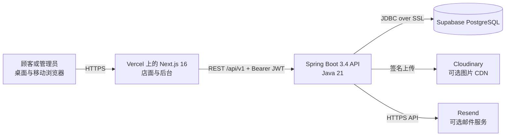
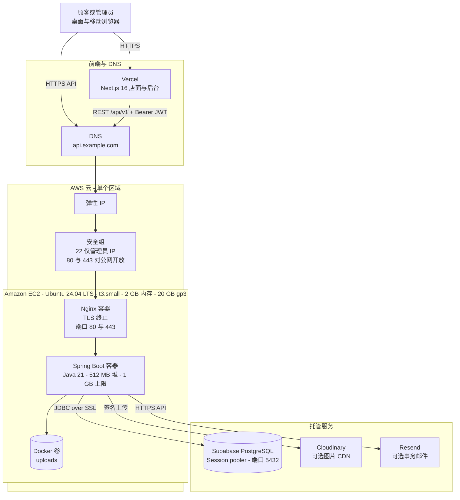
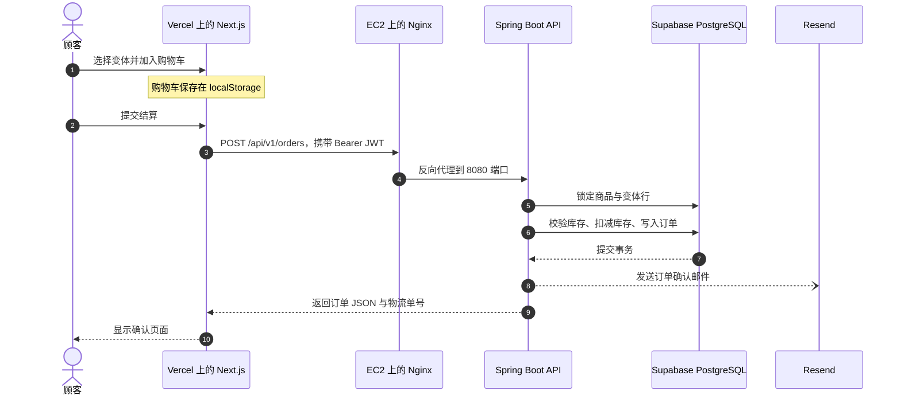
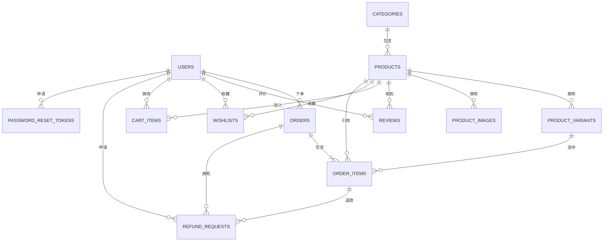

<div align="center">


# NCWU StyleHub

### 在线服装商城，包含 Java API、PostgreSQL 与 AWS 部署方案

<p>
  <strong>阅读语言：</strong>
  &nbsp;
  <a href="README.md"><kbd>English</kbd></a>
  &nbsp;·&nbsp;
  <kbd>简体中文</kbd>
</p>

这是一个面向华北水利水电大学信息工程学院《计算机系统开发综合实习 2》课程设计的全栈电子商务应用。

项目包含响应式 Next.js 店面、基于角色的后台管理、Java Spring Boot REST API、PostgreSQL 数据库，以及部署在 AWS EC2 单机上的生产式方案。

> **在线演示：** [https://shop.ncwu.site](https://shop.ncwu.site) — 在登录页点击 **快速演示登录** 即可体验顾客或只读管理员账号，也可以直接注册新账号。

[项目概览](#项目概览) · [功能](#功能) · [架构](#架构) · [快速开始](#快速开始5-分钟本地运行) · [AWS 部署](#部署-api-到-aws) · [UI/UX 设计](#uiux-设计系统) · [API](#api-参考) · [故障排查](#故障排查)


</div>

---

## 项目概览

NCWU StyleHub 是一个可以实际运行的在线服装商城，而不是静态 UI 原型。顾客可以浏览预置商品、选择款式与尺码、加入购物车、结算、查看订单、在发货前取消订单、在发货后申请退款、收藏商品，并提交需要审核的评价。管理员可以管理商品与变体、上传图片、管理用户、审核评价、更新订单状态与物流单号、处理退款、查看联系表单、管理会员，并查看销售与利润分析。

项目规模刻意保持精简，可以运行在一台 2 GB 内存的 EC2 实例上，同时保留真实项目的分层结构：独立部署的前端、无状态的 Java API、托管的 PostgreSQL 数据库、可选的 Cloudinary 图片存储，以及可选的 Resend 事务邮件。

> **项目状态：** 这是一个功能完整的课程项目。支付为演示流程，不会真实扣款。部署方式接近生产环境，但不是高可用或经过压力测试的商业系统。详见[限制与后续计划](#限制与后续计划)。

> **仓库布局：** GitHub 仓库把 Next.js 应用放在根目录（`src/`、`public/`、`package.json`）。课程开发工作区把同一个应用放在 `frontend/` 下。本文命令按 GitHub 布局编写；如果你的代码检出使用工作区布局，请在 `frontend/` 下执行前端命令。

---

## 功能

### 前台商城

| 模块 | 已实现功能 |
| --- | --- |
| 首页 | 自动轮播主视觉、分类展示、精选商品、促销横幅、新品、信任区块、会员注册 |
| 商品列表 | 搜索、分类筛选、价格区间（最低/最高）筛选、尺码筛选、按最新、价格升序、价格降序、评分排序；响应式商品网格、加载骨架屏、空状态 |
| 商品详情 | 图片画廊、款式与尺码变体、变体价格与库存、实时库存标签（有货 / 仅剩 N 件 / 已售罄）、折扣标签、数量选择、收藏、分享、“猜你喜欢”交叉推荐、评价列表与评价表单 |
| 购物车 | 基于 `localStorage` 的变体购物车、受库存限制的数量调整、小计、满 ¥80 免运费、未满收取 ¥6.90 运费 |
| 结算 | 支持游客结算或登录结算，填写收货人、地址、电话，可选择已保存的收货地址，选择支付宝、微信支付或货到付款，显示订单摘要与带物流单号的确认页 |
| 订单 | 订单历史、订单详情、物流时间线、物流单号、发货前取消、发货后申请退款、退款状态 |
| 游客订单查询 | 无需账号，凭订单号与结账邮箱查询订单状态 |
| 账户 | 个人资料摘要、订单入口、收货地址簿（新增/编辑/删除/设为默认）、物流单号复制、收藏商品、管理员后台入口 |
| 认证 | 注册、登录、退出、忘记密码、重置密码、60 分钟单次有效重置链接 |
| 收藏 | 由后端保存的收藏商品，不只依赖浏览器存储 |
| 帮助页面 | 联系我们、常见问题、配送与退货、隐私政策、服务条款 |
| 会员 | 订阅 NCWU StyleHub Club，配置邮件后发送欢迎邮件 |

### 后台管理

| 模块 | 已实现功能 |
| --- | --- |
| 仪表盘 | 营收、毛利、订单数、客单价、7/30/90 天范围、销售与利润图表、热销商品、订单状态分布、低库存与待审核评价数量 |
| 商品 | 新建、编辑、删除、设为精选、隐藏、库存管理、款式与尺码变体、文件上传图片 |
| 订单 | 按订单号或顾客搜索、更新状态、填写物流单号、永久删除订单 |
| 退款 | 查看顾客退款申请、批准或拒绝并填写备注，配置邮件后发送决定通知 |
| 评价 | 通过、拒绝或删除顾客评价 |
| 用户 | 创建顾客或管理员、修改角色、启用或禁用账户、删除账户 |
| 会员 | 查看和删除邮件订阅者 |
| 消息 | 查看联系表单收件箱、标记已读、删除消息 |
| 外观 | 在八套店面与后台配色主题之间切换，选择保存在浏览器中 |
| 演示管理员 | 独立的只读角色，可查看仪表盘、商品、评价与外观，不能修改数据 |

### 平台能力

- JWT Bearer 认证，HS256 签名，PBKDF2-HMAC-SHA256 密码哈希，支持顾客、管理员、只读演示管理员三种角色。
- 按 IP 的滑动窗口限流：登录与注册每分钟 10 次，图片上传每分钟 20 次，其余 API 每分钟 300 次。
- 带数据库连通性检查的健康检查接口 `/health`。
- H2 文件数据库回退方案，本地开发不需要安装数据库服务。
- 可选 Cloudinary 上传，未配置时回退到本地 `uploads/`。
- 可选 Resend 邮件，用于欢迎、订单、物流、取消、密码重置、退款、会员与联系通知。
- EC2 部署包含 Docker Compose、Nginx、HTTPS、持久化上传、内存限制、自动重启与日志轮转。

---

## 架构

### 系统上下文



前端不会直接连接 PostgreSQL，也不会持有数据库密码、JWT 签名密钥、Cloudinary 密钥或 Resend API Key。所有需要权限的操作都在 Java API 中完成。

### AWS 部署拓扑



### 使用的 AWS 服务

| 服务 | 在本项目中的作用 | 配置 |
| --- | --- | --- |
| Amazon EC2 | 运行 Java API 与 Nginx | Ubuntu 24.04 LTS，`t3.small` 起步规格，2 GB 内存，20 GB gp3 根卷 |
| Amazon EBS | EC2 根磁盘 | gp3，建议加密，升级前创建快照或备份 |
| 弹性 IP | 为 DNS 提供稳定公网 IPv4 | 绑定实例；删除实例时释放 |
| 安全组 | 网络边界 | SSH 22 仅允许自己的 IP，HTTP 80 与 HTTPS 443 对公网开放，不公开 8080 或 5432 |
| Route 53（可选） | 为 `api.example.com` 提供 DNS | 任何域名注册商均可；创建指向弹性 IP 的 A 记录 |
| CloudWatch（可选） | 监控与告警 | 默认未配置；生产环境建议增加 CPU、状态检查与磁盘告警 |

> **AWS 范围：** 本项目只用 AWS 运行 API 计算层。前端在 Vercel，数据库在 Supabase，图片可选放在 Cloudinary。项目没有使用 S3、CloudFront、RDS、应用负载均衡、Auto Scaling、ECS、EKS 或 Lambda。这是刻意的取舍：单台小型 EC2 让课程部署成本低、结构清晰，代价是单点故障且不能自动扩容。

### 结算与订单流程



订单金额、库存变化与运费都由服务端计算。浏览器购物车只是便利层，不能作为价格或库存的可信来源。

---

## 技术栈

| 层级 | 技术 | 版本或说明 |
| --- | --- | --- |
| 前端 | Next.js App Router | 16.4.6 |
| UI 运行时 | React 与 React DOM | 19.3.0 |
| 语言 | TypeScript | 5.x |
| 样式 | Tailwind CSS | 4.3.3，CSS 自定义属性，`@theme inline` |
| 图标 | Lucide React | SVG 图标，不使用 emoji 图标 |
| 后端 | Java | 21 |
| 后端框架 | Spring Boot、Spring Web、Spring Data JPA、Validation | 3.4.5 |
| 构建 | Maven | 3.9+ |
| 数据库 | Supabase PostgreSQL | 本地开发使用 H2 文件数据库 |
| 认证 | JWT HS256、PBKDF2-HMAC-SHA256 | 默认令牌有效期 24 小时 |
| 图片 | Cloudinary 或本地上传 | 后端签名上传 |
| 邮件 | Resend | 可选，异步发送 |
| 前端托管 | Vercel | Next.js 预设 |
| 后端托管 | AWS EC2、Docker Compose、Nginx、Certbot | 单实例 |
| 测试 | JUnit 5 与 Spring Boot Test | 目前有一个后端安全测试类，共四个用例 |

---

## 仓库结构

```text
.
├── src/                         Next.js App Router 源码
│   ├── app/                     店面、认证、账户、订单、帮助、后台
│   ├── components/              共享店面、后台与 UI 组件
│   └── lib/                     API 客户端、认证与购物车状态、主题、类型、工具
├── public/                      品牌标志与静态资源
├── java-backend/                Spring Boot REST API
│   ├── src/main/java/           控制器、服务、领域模型、安全、种子数据
│   ├── src/test/java/           后端测试
│   ├── Dockerfile               多阶段 Java 21 镜像
│   └── pom.xml                  Maven 构建
├── deploy/aws/                  EC2 Docker Compose、Nginx、HTTPS、环境变量模板
├── supabase/                    schema.sql、seed.sql 与增量迁移
├── package.json                 前端依赖与脚本
├── next.config.ts               Next.js 配置
├── vercel.json                  Vercel 构建配置
├── README.md                    English README
└── README.zh-CN.md              简体中文 README
```

在课程工作区中，`frontend/` 包含上面列出的 `src/`、`public/`、`package.json` 与 Next.js 配置。后端、部署套件与数据库文件仍位于工作区根目录。

---

## 快速开始：5 分钟本地运行

这条路径不需要云账号、不需要 Supabase 项目，也不需要 Docker。后端会自动使用 H2 文件数据库并写入演示商品。

### 环境要求

| 工具 | 最低版本 | 推荐版本 | 检查命令 |
| --- | --- | --- | --- |
| Git | 2.30 | 当前版本 | `git --version` |
| Node.js | 20.9 | 22 LTS | `node --version` |
| npm | 10 | 随 Node 安装的当前版本 | `npm --version` |
| JDK | 21 | Eclipse Temurin 21 | `java -version` |
| Maven | 3.9 | 当前 3.9.x | `mvn --version` |
| Docker | 24 | 当前版本，含 Compose v2 | `docker --version`（可选） |

可选账号：Supabase 用于 PostgreSQL，Cloudinary 用于图片 CDN，Resend 用于邮件，AWS 用于 EC2 部署。

### 1. 克隆仓库

```bash
git clone https://github.com/miltonbabu/ncwu-stylehub.git
cd ncwu-stylehub
```

### 2. 启动 API

在 `java-backend` 目录打开终端：

```bash
cd java-backend
mvn spring-boot:run
```

API 默认运行在 `http://localhost:8080`。首次启动会创建 `java-backend/data/stylehub.mv.db`，建立数据库结构，并写入分类、商品、变体、横幅、促销、评价、演示顾客与只读演示管理员。

验证：

```bash
curl http://localhost:8080/health
```

预期响应：

```json
{"status":"ok"}
```

本地行为说明：

- 没有设置 `DATABASE_URL` 时使用 H2，而不是 PostgreSQL。
- `APP_DEMO_ENABLED` 默认为 `true`，因此会写入演示商品与演示顾客。
- `APP_DEMO_ADMIN_ENABLED` 默认为 `true`，因此会创建只读演示管理员。
- 如果没有设置 `SECRET_KEY`，API 每次启动都会生成随机签名密钥。重启后旧令牌会失效。如果不想每次重启都重新登录，请在本地设置固定的 `SECRET_KEY`。

### 3. 启动店面

在包含 `package.json` 的目录打开第二个终端（GitHub 仓库根目录，或课程工作区的 `frontend/`）：

```bash
npm ci
```

在同一目录创建 `.env.local`：

```dotenv
NEXT_PUBLIC_API_URL=http://localhost:8080
```

启动开发服务器：

```bash
npm run dev
```

打开 [http://localhost:3000](http://localhost:3000)。商品、认证、订单与后台页面需要 API 正在运行。修改 `NEXT_PUBLIC_API_URL` 后需要重启前端，因为该变量在构建时写入。

### 4. 登录

登录页提供 **Quick demo access** 快捷按钮，可以自动填入以下账号。

| 角色 | 邮箱 | 密码 | 权限 |
| --- | --- | --- | --- |
| 顾客 | `user@shop.ncwu.site` | `demo@123` | 店面、购物车、结算、订单、收藏、评价 |
| 演示管理员 | `demo-admin@shop.ncwu.site` | `demo-admin@123` | 只读仪表盘、商品、评价、外观 |
| 完整管理员（仅 Supabase 种子） | `admin@shop.ncwu.site` | `admin@123` | 完整后台；请立即修改密码 |
| 完整管理员（本地 H2） | 默认无 | 默认无 | 需要提升已注册账号，见下文 |

> **重要：** 本地 H2 数据库不会创建完整管理员，这是刻意设计。演示管理员是只读角色。要在本地管理商品、用户、订单与退款，请按[创建完整管理员](#创建完整管理员)提升自己的账号。

### 5. 冒烟测试

- [ ] 首页加载主视觉轮播、分类、精选商品与促销。
- [ ] 商品列表的搜索、分类筛选与排序可用。
- [ ] 商品详情显示款式与尺码，并随选择更新价格与库存。
- [ ] 使用演示顾客加入购物车、打开购物车并完成结算。
- [ ] 订单出现在 **My Orders** 中，并显示物流单号与时间线。
- [ ] 使用演示管理员登录，仪表盘可以加载，且没有编辑按钮。
- [ ] `GET /health` 返回 `{"status":"ok"}`。

---

## 创建完整管理员

### 方式 A：Supabase SQL 编辑器

通过 `/auth/sign-up` 注册一个普通账号，然后在 Supabase SQL 编辑器执行：

```sql
UPDATE users
SET role = 'admin'
WHERE email = 'you@example.com';
```

退出并重新登录。角色写在 JWT 中，旧令牌会保留旧角色，直到过期或重新登录。

### 方式 B：本地 H2 数据库

1. 使用 `Ctrl+C` 停止 API，避免 H2 文件被锁定。
2. 使用常用 SQL 客户端打开 H2 文件，例如 DBeaver 或 IntelliJ Database：
   - JDBC URL：`jdbc:h2:file:C:/Online store web app/java-backend/data/stylehub`
   - 用户：`sa`
   - 密码：留空
3. 执行同一条 `UPDATE users SET role = 'admin' WHERE email = 'you@example.com';`。
4. 重新运行 `mvn spring-boot:run` 并重新登录。

H2 Shell 示例命令如下。请把 H2 jar 路径替换为你 Maven 仓库中的实际版本：

```bash
java -cp "<path-to-h2.jar>" org.h2.tools.Shell \
  -url "jdbc:h2:file:./data/stylehub" \
  -user sa \
  -password "" \
  -sql "UPDATE users SET role='admin' WHERE email='you@example.com';"
```

### 方式 C：使用演示种子的全新 Supabase 数据库

如果在全新数据库执行 `supabase/seed.sql`，会创建一个完整管理员：

```text
邮箱：admin@shop.ncwu.site
密码：admin@123
```

请立即修改密码，或创建自己的账号并提升角色。不要在公开部署中保留已知演示凭据。

### 生产环境禁用演示账号

在后端主机设置：

```dotenv
APP_DEMO_ENABLED=false
APP_DEMO_ADMIN_ENABLED=false
```

第一项停止演示商品与演示顾客写入，第二项停止重新创建只读演示管理员。EC2 Compose 文件已将两项默认设为 `false`；如果你覆盖了它们，请检查 `.env`。

---

## 配置参考

### 前端

| 变量 | 是否必需 | 示例 | 说明 |
| --- | --- | --- | --- |
| `NEXT_PUBLIC_API_URL` | 生产环境必需 | `https://api.example.com` | 只填后端基础地址。不要带尾部斜杠，不要追加 `/api/v1`。该变量在构建时写入，修改后需要重新部署。未设置时客户端回退到 `http://localhost:8080`。 |

不要把数据库密码、JWT 密钥、Cloudinary API Secret、Resend API Key 或 Supabase service-role key 放进任何 `NEXT_PUBLIC_*` 变量。该前缀下的内容会暴露给浏览器。

### 后端

| 变量 | 是否必需 | 默认值 | 用途 |
| --- | --- | --- | --- |
| `DATABASE_URL` | 生产环境 | 空，使用 H2 | PostgreSQL 连接地址。支持 `postgresql://` 或 `postgres://`。Supabase 建议带 `?sslmode=require`。从操作系统环境变量读取。 |
| `DATABASE_USER` | 使用 Supabase 时 | 从 URL 解析，否则 `postgres` | Supabase pooler 用户，通常是 `postgres.PROJECT_REF`。从操作系统环境变量读取。 |
| `DATABASE_PASSWORD` | 使用 Supabase 时 | 空 | 数据库密码。建议使用独立凭据。从操作系统环境变量读取。 |
| `SECRET_KEY` | 生产环境 | 每次启动随机生成 | JWT 签名密钥。至少 32 个随机字符。固定值可以让令牌在重启后继续有效。 |
| `ACCESS_TOKEN_EXPIRE_MINUTES` | 否 | `1440` | 令牌有效期，单位分钟，默认 24 小时。 |
| `CORS_ORIGINS` | 生产环境 | `http://localhost:3000,http://127.0.0.1:3000` | 允许的前端来源，逗号分隔，不要有空格，不要带尾部斜杠。从操作系统环境变量读取。 |
| `SERVER_PORT` | 否 | `8080` | API 监听端口。 |
| `APP_DEMO_ENABLED` | 否 | `true` | 写入演示商品与演示顾客。生产环境设为 `false`。 |
| `APP_DEMO_ADMIN_ENABLED` | 否 | `true` | 创建只读演示管理员。生产环境设为 `false`。 |
| `DEMO_ADMIN_EMAIL` | 否 | `demo-admin@shop.ncwu.site` | 演示管理员邮箱，仅在启用演示管理员时使用。 |
| `DEMO_ADMIN_PASSWORD` | 否 | `demo-admin@123` | 演示管理员密码，仅在启用演示管理员时使用。 |
| `CLOUDINARY_CLOUD_NAME` | 否 | 空 | Cloudinary cloud name。 |
| `CLOUDINARY_API_KEY` | 否 | 空 | Cloudinary API Key。 |
| `CLOUDINARY_API_SECRET` | 否 | 空 | Cloudinary API Secret，仅后端使用。 |
| `CLOUDINARY_FOLDER` | 否 | `ncwu-stylehub` | Cloudinary 上传目录。 |
| `RESEND_API_KEY` | 否 | 空 | 设置后启用事务邮件。 |
| `MAIL_FROM` | 否 | `NCWU StyleHub <info@shop.ncwu.site>` | 发件地址，必须在 Resend 中验证。 |
| `SITE_URL` | 否 | `https://shop.ncwu.site` | 邮件链接使用的公开前端地址，不要带尾部斜杠。 |
| `ADMIN_EMAIL` | 否 | `md.milton@qq.com` | 接收联系表单与退款提醒的邮箱。 |

### 配置读取位置

后端有两套配置读取方式，这一点容易出错：

- `SECRET_KEY`、`ACCESS_TOKEN_EXPIRE_MINUTES`、演示开关、Cloudinary、Resend、`MAIL_FROM`、`SITE_URL`、`ADMIN_EMAIL` 通过后端 `Env` 工具读取，先查操作系统环境变量，再查 `java-backend/.env`。
- `DATABASE_URL`、`DATABASE_USER`、`DATABASE_PASSWORD`、`CORS_ORIGINS` 由数据源与 Web 配置直接从操作系统环境变量读取。

本地运行时，请在终端导出数据库与 CORS 配置：

**PowerShell**

```powershell
$env:DATABASE_URL = "postgresql://aws-0-REGION.pooler.supabase.com:5432/postgres?sslmode=require"
$env:DATABASE_USER = "postgres.PROJECT_REF"
$env:DATABASE_PASSWORD = "your-database-password"
$env:SECRET_KEY = "a-long-random-secret"
$env:CORS_ORIGINS = "http://localhost:3000"
cd java-backend
mvn spring-boot:run
```

**macOS 或 Linux**

```bash
export DATABASE_URL="postgresql://aws-0-REGION.pooler.supabase.com:5432/postgres?sslmode=require"
export DATABASE_USER="postgres.PROJECT_REF"
export DATABASE_PASSWORD="your-database-password"
export SECRET_KEY="a-long-random-secret"
export CORS_ORIGINS="http://localhost:3000"
cd java-backend
mvn spring-boot:run
```

Docker Compose 会显式传递这些变量，因此 EC2 部署不依赖 shell 导出。

### 密钥规则

- 不要提交 `.env`、`.env.local`、数据库密码、JWT 密钥、Cloudinary 密钥或 Resend Key。
- 使用 `openssl rand -hex 32` 或密码管理器生成 JWT 密钥。
- Supabase 使用 **Session pooler** 的 5432 端口凭据，不要把数据库密码放进前端变量。
- 前端只需要 `NEXT_PUBLIC_API_URL`。Cloudinary 与 Resend 只放在后端。
- 公开上线前修改或禁用所有演示账号。
- JWT 与用户信息保存在浏览器 `localStorage`。这种方式简单，适合课程项目，但任何 XSS 都可能窃取令牌。加固时请增加严格的 Content Security Policy，并避免渲染不可信 HTML。

---

## 数据库

### 全新 Supabase 项目

1. 在 [supabase.com](https://supabase.com) 创建项目。
2. 打开 **SQL Editor**，执行 [`supabase/schema.sql`](supabase/schema.sql)。
3. 按文件名顺序执行 [`supabase/migrations/`](supabase/migrations) 中的迁移。迁移使用 `IF NOT EXISTS` 保护，并补充基础 schema 可能缺少的功能，例如密码重置令牌。
4. 可选：执行一次 [`supabase/seed.sql`](supabase/seed.sql)，写入演示商品、演示顾客与完整演示管理员。不要在线上数据库重复执行。
5. 打开 **Connect**，复制 **Session pooler** 的 5432 端口连接串。
6. 在后端设置 `DATABASE_URL`、`DATABASE_USER`、`DATABASE_PASSWORD`。
7. 启动 API 并检查 `/health`。

### 已有数据库

先备份，再按顺序执行迁移：

| 顺序 | 迁移文件 | 增加内容 |
| --- | --- | --- |
| 1 | `20261115-club-and-order-updates.sql` | 会员订阅者、订单 `updated_at` |
| 2 | `20261115-cost-profit-password-reset.sql` | 商品成本、订单行成本、密码重置令牌 |
| 3 | `20261115-sizes-wishlist-tracking.sql` | 商品尺码、购物车与订单尺码、物流单号、收藏 |
| 4 | `20261116-contact-messages.sql` | 联系表单收件箱 |
| 5 | `20261121-product-variants-refunds.sql` | 商品变体、变体库存、退款申请，并回填已有尺码商品 |
| 6 | `20261125-more-products.sql` | 各分类共 12 个新增商品，按 slug 匹配，可安全重复执行 |
| 7 | `20261128-address-book-guest-checkout.sql` | 收货地址簿表、`orders.guest_email`、游客结算所需的可空 `orders.user_id` |

不要在线上数据库重复执行 `seed.sql`。它使用固定 ID 与演示用户，会与真实数据冲突。

Hibernate 使用 `ddl-auto=update`，也可能补充缺失字段。请把 SQL schema 与迁移作为受控路径，只把 Hibernate 更新当作开发便利。

### 数据模型



| 表 | 用途 |
| --- | --- |
| `users` | 顾客、管理员、只读演示管理员、密码哈希、启用状态 |
| `categories` | 商品分类与展示顺序 |
| `products` | 商品信息、价格、划线价、成本、库存、尺码、精选与启用状态 |
| `product_variants` | 款式与尺码组合，各自拥有价格、成本、库存与图片 |
| `product_images` | 商品附加画廊图片 |
| `reviews` | 评分与评论，状态为待审核、通过或拒绝 |
| `cart_items` | 服务端购物车模型；当前店面购物车保存在浏览器 |
| `wishlists` | 用户收藏商品 |
| `addresses` | 用户保存的收货地址，每位顾客仅有一个默认地址 |
| `orders` | 订单头、状态、总额、收货信息、支付方式、物流单号、时间戳；游客订单以 `guest_email` 标识 |
| `order_items` | 购买行，保存商品名、价格、成本、款式、尺码与变体引用 |
| `refund_requests` | 退款数量、原因、状态、管理员备注、申请与处理时间 |
| `banners` | 首页主视觉轮播 |
| `promotions` | 首页促销区块 |
| `subscribers` | NCWU StyleHub Club 会员 |
| `contact_messages` | 联系表单收件箱与已读状态 |
| `password_reset_tokens` | 哈希存储、单次使用、60 分钟有效的重置令牌 |

### 本地 H2

- 文件：`java-backend/data/stylehub.mv.db`
- 用户：`sa`，密码为空
- 完全重置：停止 API，删除 `java-backend/data/` 与 `java-backend/uploads/`，重新启动。数据库与演示商品会重新创建。
- H2 只用于本地开发。共享或公开环境请使用 PostgreSQL。

### 备份

- Supabase：启用定时备份，或在迁移前手动备份。
- Docker 上传：备份 `uploads` 卷，或使用 Cloudinary 把图片放到实例之外。
- EC2：升级系统或 Docker 前创建根卷快照。
- 要实际测试恢复，而不只是创建备份。

---

## 图片上传

管理员通过 `POST /api/v1/admin/products/{id}/images` 上传商品图片。

| 行为 | 说明 |
| --- | --- |
| 最大尺寸 | 单张 5 MB，请求最大 10 MB |
| 允许类型 | `.png`、`.jpg`、`.jpeg`、`.webp`、`.gif` |
| 限流 | 每个 IP 每分钟 20 次上传 |
| 已配置 Cloudinary | 后端签名上传，保存返回的 `secure_url` |
| 未配置 Cloudinary | 保存到 `uploads/`，通过 `/uploads/<file>` 访问 |
| Docker 部署 | `uploads` 命名卷在容器重建后保留文件 |
| 前端 | 请求 Cloudinary 图片时使用 `f_auto,q_auto` 与合适尺寸 |

生产环境推荐 Cloudinary，因为本地上传绑定在单台 EC2 与其卷上。Cloudinary 密钥只能设置在后端，不能放在 Vercel。

---

## 邮件

邮件是可选功能。没有 `RESEND_API_KEY` 时，后端会记录警告并跳过发送；注册、结算、取消、退款与密码重置请求仍然可用。

启用后，Resend 会发送：

- 注册后的欢迎邮件。
- 订单确认邮件，包含商品与物流单号。
- 订单状态与物流更新。
- 订单取消确认。
- 密码重置链接，60 分钟内有效且只能使用一次。
- 退款申请提醒到 `ADMIN_EMAIL`。
- 退款决定通知给顾客。
- 会员欢迎邮件。
- 联系表单消息到 `ADMIN_EMAIL`，并把发件人设为 reply-to。

`MAIL_FROM` 必须使用 Resend 中验证过的发件人或域名。`SITE_URL` 控制邮件内链接，请设置为公开前端地址，不要带尾部斜杠。

---

## 构建、测试与质量检查

| 任务 | 命令 | 说明 |
| --- | --- | --- |
| 后端测试 | `cd java-backend && mvn test` | 运行 Spring Boot 测试套件 |
| 后端打包 | `cd java-backend && mvn package -DskipTests` | 生成 `target/stylehub-api-1.0.0.jar` |
| 运行打包 API | `java -jar target/stylehub-api-1.0.0.jar` | 在 `java-backend/` 下执行 |
| 前端 Lint | `npm run lint` | 使用 Next.js 配置的 ESLint。当前代码树存在既有的 `react-hooks/set-state-in-effect` 问题与图片警告，因此请把生产构建作为发布门槛，并修复你修改文件中的 lint 问题。 |
| 前端生产构建 | `npm run build` | 验证 Next.js 生产包；这是前端发布门槛 |
| 前端生产启动 | `npm start` | 在 3000 端口运行构建结果 |
| 后端 Docker 镜像 | `docker build -t stylehub-api ./java-backend` | 多阶段 Java 21 构建 |

目前没有前端单元测试，也没有端到端测试。`npm run build` 是前端构建门槛，上面的手动冒烟测试是功能发布检查。后续扩展时，建议优先增加 Playwright 或 Cypress 对登录、结算与后台审核的覆盖。

### 手动 QA 清单

- [ ] 注册、登录、退出，并在配置邮件后重置密码。
- [ ] 搜索与筛选商品，打开包含多个款式与尺码的商品。
- [ ] 选择变体加入购物车，修改数量、删除、再次加入。
- [ ] 分别在 ¥80 免运费门槛以下与以上结算。
- [ ] 取消待处理订单，确认库存已恢复。
- [ ] 以管理员身份把订单改为已发货、填写物流单号，确认顾客时间线更新。
- [ ] 顾客申请退款，管理员批准，确认双方邮件。
- [ ] 提交评价，并在后台通过或拒绝。
- [ ] 上传商品图片，确认店面显示。
- [ ] 切换主题并刷新，确认选择保留。
- [ ] 在 375 px、768 px、1024 px、1440 px 宽度检查布局。

---

## 部署 API 到 AWS

完整、可复制的部署步骤在 [`deploy/aws/README.md`](deploy/aws/README.md)。下面的摘要帮助你理解部署结构；实际命令与 Certbot 钩子请按详细指南执行。

### 开始之前

- 一个可以创建 EC2、EBS、弹性 IP 与安全组的 AWS 账号。
- 一个已执行 schema 与迁移的 Supabase 项目。
- 一个用于 API 的域名或子域名，例如 `api.example.com`。
- 一个 Vercel 账号用于前端。
- 可选的 Cloudinary 与 Resend 账号。

AWS 价格与免费额度取决于账号、区域与用量。`t3.small` 是轻量流量的起步规格，不保证在免费额度内。启动前请确认当前价格。

### 1. 启动实例

- Ubuntu 24.04 LTS。
- `t3.small` 或类似的 2 GB 实例。
- 至少 20 GB gp3 存储。
- 绑定弹性 IP。
- 入站 TCP 22 仅允许自己的 IP，TCP 80 与 443 对公网开放。
- 不要公开 8080 或 5432。

### 2. 安装运行环境

```bash
sudo apt-get update
sudo apt-get install -y docker.io docker-compose-v2 git certbot
sudo systemctl enable --now docker
sudo usermod -aG docker "$USER"
```

重新登录后再不使用 `sudo` 运行 Docker。2 GB 实例构建时如果内存不足，可以增加 2 GB swap。Swap 只帮助构建，不能替代内存。

### 3. 配置后端

```bash
git clone https://github.com/miltonbabu/ncwu-stylehub.git stylehub
cd stylehub/deploy/aws
cp .env.example .env
chmod 600 .env
openssl rand -hex 32
nano .env
```

填写：

- `DATABASE_URL`：Supabase Session pooler 地址，端口 `5432`，带 `?sslmode=require`。
- `DATABASE_USER`：pooler 用户，通常是 `postgres.PROJECT_REF`。
- `DATABASE_PASSWORD`：数据库密码。
- `SECRET_KEY`：`openssl rand -hex 32` 生成的值。
- `CORS_ORIGINS`：精确的前端来源，不带尾部斜杠，不使用通配符。
- `SITE_URL`：公开前端地址。
- `ADMIN_EMAIL`：接收联系与退款提醒的邮箱。
- `RESEND_API_KEY` 与 `MAIL_FROM`：需要邮件时填写。
- Cloudinary 配置：需要 CDN 上传时填写。
- 生产环境设置 `APP_DEMO_ENABLED=false` 与 `APP_DEMO_ADMIN_ENABLED=false`。

Compose `.env` 中包含 `$` 或 `#` 的值需要加引号。

### 4. 构建并启动

```bash
docker compose config --quiet
docker compose build api
docker compose up -d
docker compose ps
docker compose logs --tail=100 api
curl --fail http://localhost/health
```

API 容器使用 512 MB Java 堆与 1 GB 容器上限。Nginx 上限 64 MB。这些是轻量流量的起步值，不是容量保证。

上传图片保存在 `uploads` Docker 卷中。除非确定要删除，否则不要执行 `docker compose down -v`。

### 5. 启用 HTTPS

HTTPS 的 Vercel 前端无法调用 HTTP API，浏览器会阻止混合内容。把 `api.example.com` 指向弹性 IP，并等待 DNS 生效。

```bash
docker compose stop web
sudo certbot certonly --standalone --cert-name stylehub -d api.example.com
```

签发成功后，永久启用 HTTPS 覆盖配置：

```bash
printf '\nCOMPOSE_FILE=docker-compose.yml:docker-compose.https.yml\n' >> .env
docker compose up -d web
curl --fail https://api.example.com/health
```

80 端口会重定向到 HTTPS，443 端口提供 API。如果证书签发失败，执行 `docker compose start web` 恢复 HTTP，再检查 DNS 或安全组。

按详细指南安装续期钩子，然后执行：

```bash
sudo systemctl enable --now certbot.timer
sudo certbot renew --dry-run
```

### 6. 部署前端到 Vercel

1. 在 Vercel 导入 `https://github.com/miltonbabu/ncwu-stylehub`。
2. Framework Preset 选择 Next.js。
3. Root Directory：GitHub 布局保持仓库根目录。如果你的 fork 把应用放在 `frontend/`，把 Root Directory 设为 `frontend`。
4. 在 Production 与 Preview 添加 `NEXT_PUBLIC_API_URL=https://api.example.com`。
5. 部署。
6. 确认 EC2 上的 `CORS_ORIGINS` 与 Vercel 来源完全一致，且没有尾部斜杠。
7. 修改 `NEXT_PUBLIC_API_URL` 后重新部署前端。

### 7. 验证部署

```bash
curl --fail https://api.example.com/health
curl --fail https://api.example.com/api/v1/products
```

然后打开 Vercel 地址检查：

- 商品与图片可以加载。
- 登录可用。
- 可以创建测试订单。
- 完整管理员可以打开后台仪表盘。
- 图片上传可用，返回的 URL 可以打开。
- 配置 Resend 后，密码重置与订单邮件可以收到。

### 更新与回滚

后端变更推送后：

```bash
cd ~/stylehub
git pull --ff-only
cd deploy/aws
docker compose build api
docker compose up -d
docker compose logs --tail=100 api web
curl --fail http://localhost/health
```

回滚时，切换到之前的 Git 提交，重新构建 API 镜像并重建容器。本项目数据库迁移只向前执行，因此应用迁移前必须备份，并准备恢复方案。

### 生产加固清单

- [ ] `APP_DEMO_ENABLED=false` 与 `APP_DEMO_ADMIN_ENABLED=false`。
- [ ] 使用强且稳定的 `SECRET_KEY`。
- [ ] `CORS_ORIGINS` 精确匹配，不使用通配符。
- [ ] SSH 仅允许自己的 IP；可以考虑用 AWS Systems Manager Session Manager 替代公网 SSH。
- [ ] 8080 与 5432 不对公网开放。
- [ ] 启用 HTTPS，并测试续期。
- [ ] 启用 Supabase 备份并测试恢复。
- [ ] 备份上传文件，或配置 Cloudinary。
- [ ] 删除、禁用或修改演示用户密码。
- [ ] 增加 CloudWatch 的 CPU、状态检查与磁盘告警。
- [ ] 制定日志检查与保留策略。
- [ ] 理解限流是单实例内存实现。
- [ ] 为数据库迁移准备预发环境或维护窗口。

---

## UI/UX 设计系统

视觉系统主要由 [`src/app/globals.css`](https://github.com/miltonbabu/ncwu-stylehub/blob/main/src/app/globals.css)、[`src/lib/themes.ts`](https://github.com/miltonbabu/ncwu-stylehub/blob/main/src/lib/themes.ts) 与 [`src/components/`](https://github.com/miltonbabu/ncwu-stylehub/tree/main/src/components) 下的共享组件实现。构建应用不需要额外的设计文件。

### 设计原则

- **编辑感，而不是玩具感。** 充足留白、大图、克制的边框与中性底色让服装成为视觉焦点。
- **轻玻璃，而不是重玻璃。** 视觉语言受 Liquid Glass 启发：吸顶导航与移动端标签栏使用半透明白色与背景模糊。效果只用于导航与浮层，保证内容可读性与性能。
- **以转化为导向的层级。** 商品页把价格、折扣、库存、尺码与主操作放在一起；收藏与分享等次要操作视觉上更安静。
- **统一 Token，运行时主题。** 颜色由 CSS 自定义属性驱动，所有表面、按钮、徽章与图表都会随主题变化，无需重写组件。
- **移动优先，适合拇指操作。** 移动端底部标签栏、较大的点击区域与纵向商品布局是一等公民，而不是事后补充。

### 主题

项目提供八套运行时主题，默认是 **Aurora**。完整管理员可以在后台顶部或外观页面切换主题；保存的主题会同时应用到店面与后台。选择保存在 `localStorage` 的 `stylehub_theme` 中，并在首次绘制前应用，避免闪烁。

| 主题 | 风格 | 主色 | 强调色 | 页面底色 |
| --- | --- | --- | --- | --- |
| Aurora | 紫罗兰与青色，现代大胆 | `#6d28d9` | `#06b6d4` | `#f7f5ff` |
| Sunset | 橙色与亮粉，高能量 | `#ea580c` | `#db2777` | `#fff7ed` |
| Emerald | 清新绿色与青柠，干净平静 | `#059669` | `#84cc16` | `#f0fdf9` |
| Ocean | 天蓝与靛蓝，清爽可信 | `#0284c7` | `#4f46e5` | `#f0f9ff` |
| Candy | 玫红与紫罗兰，活泼跳跃 | `#db2777` | `#8b5cf6` | `#fdf4ff` |
| Royal | 靛蓝与琥珀，高级对比 | `#4338ca` | `#d97706` | `#f5f6ff` |
| Citrus | 橄榄与琥珀，温暖明亮 | `#4d7c0f` | `#f59e0b` | `#f7fee7` |
| Noir | 墨黑与橙色，极简街头 | `#18181b` | `#f97316` | `#fafafa` |

组件统一使用这些 Token：`--brand`、`--brand-dark`、`--brand-soft`、`--accent`、`--accent-dark`、`--page`、`--surface`、`--ink`、`--tint`、`--gold`。Tailwind 别名为 `primary`、`primary-dark`、`primary-light`、`secondary`、`accent`、`accent-dark`、`brand-bg`、`brand-soft`、`brand-text`、`brand-tint`、`surface`、`gold`。

### 字体

| 用途 | 字体 | 说明 |
| --- | --- | --- |
| 标题 | Bricolage Grotesque | 通过 `next/font/google` 加载，`display: swap`，较紧的字距 |
| 正文 | Inter Tight | 通过 `next/font/google` 加载，`display: swap`，中性易读 |
| 数字 | 后台表格与 KPI 使用等宽数字 | 让仪表盘数据对齐 |

### 布局与导航

- 店面结构：公告栏、吸顶半透明头部、主内容、页脚、移动端底部标签栏。
- 头部：品牌、主导航、搜索、收藏、带数量角标的购物车、账户菜单、登录入口。
- 移动端：可折叠导航抽屉、可展开搜索框、底部标签栏包含首页、商城、购物车、订单、账户。
- 后台：桌面端固定深色侧边栏，移动端滑入抽屉，吸顶顶栏包含完整管理员可见的主题选择器、角色徽章与账户摘要。
- 容器：`max-w-7xl`（80 rem / 1280 px），带响应式水平内边距。
- 卡片：`rounded-2xl`，默认 `shadow-sm`，悬停 `shadow-md`；主视觉与商品大图使用更大的 `rounded-3xl` 圆角。

### 组件与交互

- 主按钮使用品牌色到强调色的渐变；次要按钮使用描边或浅色品牌填充。
- 分类、尺码、款式、状态与筛选使用胶囊形标签。
- 商品卡使用 4:5 图片比例、紧凑信息块与清晰价格层级。
- 徽章用于折扣、精选、库存、订单状态与审核状态。
- 表单使用带标签字段、可见焦点环、行内校验消息与禁用/加载状态。
- 危险操作使用确认提示与红色视觉。
- 商品与订单等关键后台表格在小屏幕上折叠为卡片，而不是强制横向滚动。

### 响应式行为

| 宽度 | 预期行为 |
| --- | --- |
| 375 px | 详情单列、商品两列、底部标签栏、后台卡片堆叠 |
| 768 px | 商品详情两列、商品三列、表单更宽 |
| 1024 px | 桌面头部导航、商品四列、固定后台侧边栏 |
| 1440 px | 居中 1280 px 内容容器，留出充足外边距 |

请在 375、768、1024、1440 px 下测试。使用真实内容，而不只是种子商品，因为长商品名与长地址最容易暴露布局问题。

### 动效

- 悬停与颜色过渡约 150 到 300 ms。
- 入场动画约 400 到 600 ms，使用平滑缓动。
- 商品网格以 50 ms 递增延迟错峰出现。
- 加载占位使用 shimmer 或 pulse，而不是空白页面。
- 主题切换会在一帧内禁用过渡，让整页立即重绘，而不是让所有颜色逐一亮起。
- `prefers-reduced-motion: reduce` 会把动画与过渡降到接近零，并关闭平滑滚动。

### 可访问性

- 使用语义化地标与标题，包括单一的 `<main>` 内容区域。
- 交互控件有可见的 `focus-visible` 焦点环。
- 图标按钮、菜单与主题选项使用 `aria-label`、`aria-expanded`、`aria-pressed`、`aria-haspopup`。
- 导航、菜单与表单支持键盘操作。
- 有意义的图片提供替代文本；装饰图标对辅助技术隐藏。
- 状态消息在适当位置使用 `role="alert"`。
- 正文对比度目标至少 4.5:1；自定义主题请用对比度工具检查。
- 全局支持减少动效偏好。

### 状态设计

- **加载：** 首页与商城使用骨架卡，后台表格使用 pulse 区块，认证状态解析时显示加载指示。
- **空状态：** 无商品、无订单、无退款申请、无销售数据时显示友好空状态，并给出下一步操作。
- **错误：** 表单行内错误、API 错误消息，以及令牌过期时跳转登录。
- **成功：** 确认页、行内提示，以及加入购物车等操作的轻量反馈。
- **禁用：** 缺货尺码、不可用操作与请求中的按钮有明确禁用样式。
- **持久化：** 购物车、认证令牌、用户摘要与主题保存在 `localStorage`；收藏与订单由服务端保存。

### 后台体验

- 仪表盘优先展示营收、利润、订单与客单价，其次是趋势图，最后是热销商品与审核队列。
- 利润使用结算时记录在订单行上的成本，并扣除已批准退款，因此后续成本变化不会改写历史。
- 演示管理员会看到明确的 **Demo - Read Only** 徽章，并且只能访问允许的页面。
- 商品编辑包含变体、库存、精选与启用状态，以及图片上传。
- 订单管理把状态与物流单号放在同一行，删除操作单独放置并要求确认。

### 设计系统说明

- 发布仓库包含已实现的设计 Token 与组件，不包含单独的设计工具文件。
- 课程工作区中的 `design-system/MASTER.md` 是设计笔记，刻意不发布。代码是唯一事实来源。
- 新组件应继续使用现有 Token 别名，而不是硬编码十六进制颜色。这样八套主题才能同时生效。

---

## API 参考

应用接口使用 `/api/v1` 前缀。`/health` 与 `/uploads/**` 位于根路径。认证使用 `Authorization: Bearer <token>`。公开商品读取与认证接口不需要令牌。

### 公开接口

| 方法 | 路径 | 用途 |
| --- | --- | --- |
| `GET` | `/health` | 带数据库检查的健康检查 |
| `POST` | `/api/v1/auth/register` | 创建顾客账号 |
| `POST` | `/api/v1/auth/login` | 登录并获取 JWT |
| `POST` | `/api/v1/auth/forgot-password` | 请求重置链接，不暴露邮箱是否存在 |
| `POST` | `/api/v1/auth/reset-password` | 使用重置令牌设置新密码 |
| `GET` | `/api/v1/categories` | 分类列表 |
| `GET` | `/api/v1/products` | 商品列表，支持搜索、分类、精选、排序、分页 |
| `GET` | `/api/v1/products/{id}` | 商品详情，包含变体与图片 |
| `GET` | `/api/v1/banners` | 首页横幅 |
| `GET` | `/api/v1/promotions` | 首页促销 |
| `GET` | `/api/v1/reviews/product/{productId}` | 商品的已通过评价 |
| `POST` | `/api/v1/newsletter` | 加入会员 |
| `POST` | `/api/v1/contact` | 提交联系表单 |
| `GET` | `/uploads/**` | 本地存储图片 |

### 已登录顾客接口

| 方法 | 路径 | 用途 |
| --- | --- | --- |
| `GET` | `/api/v1/auth/me` | 当前用户资料 |
| `GET` | `/api/v1/cart` | 服务端购物车 |
| `POST` | `/api/v1/cart/items` | 加入购物车 |
| `PUT` | `/api/v1/cart/items/{itemId}` | 更新数量 |
| `DELETE` | `/api/v1/cart/items/{itemId}` | 删除商品 |
| `DELETE` | `/api/v1/cart` | 清空购物车 |
| `GET` | `/api/v1/wishlist` | 收藏列表 |
| `POST` | `/api/v1/wishlist/{productId}` | 收藏商品 |
| `DELETE` | `/api/v1/wishlist/{productId}` | 取消收藏 |
| `POST` | `/api/v1/orders` | 创建订单 |
| `GET` | `/api/v1/orders` | 我的订单 |
| `GET` | `/api/v1/orders/{orderId}` | 订单详情 |
| `POST` | `/api/v1/orders/{orderId}/cancel` | 取消未发货订单 |
| `GET` | `/api/v1/orders/refunds` | 我的退款申请 |
| `POST` | `/api/v1/orders/refunds` | 申请退款 |
| `POST` | `/api/v1/reviews` | 提交待审核评价 |

### 管理员接口

| 方法 | 路径 | 用途 |
| --- | --- | --- |
| `GET` | `/api/v1/admin/products` | 所有商品，包括隐藏商品 |
| `GET` | `/api/v1/admin/products/{id}` | 编辑用商品详情 |
| `POST` | `/api/v1/admin/products` | 创建商品 |
| `PUT` | `/api/v1/admin/products/{id}` | 更新商品 |
| `DELETE` | `/api/v1/admin/products/{id}` | 删除商品 |
| `POST` | `/api/v1/admin/products/{id}/images` | 上传图片 |
| `GET` | `/api/v1/admin/users` | 用户列表 |
| `POST` | `/api/v1/admin/users` | 创建用户 |
| `PATCH` | `/api/v1/admin/users/{id}` | 修改角色或启用状态 |
| `DELETE` | `/api/v1/admin/users/{id}` | 删除用户 |
| `GET` | `/api/v1/admin/reviews` | 评价队列，可按状态筛选 |
| `POST` | `/api/v1/admin/reviews/{id}/approve` | 通过评价 |
| `POST` | `/api/v1/admin/reviews/{id}/reject` | 拒绝评价 |
| `DELETE` | `/api/v1/admin/reviews/{id}` | 删除评价 |
| `GET` | `/api/v1/admin/orders` | 所有订单 |
| `PATCH` | `/api/v1/admin/orders/{id}` | 更新状态或物流单号 |
| `PUT` | `/api/v1/admin/orders/{id}` | 更新状态或物流单号 |
| `DELETE` | `/api/v1/admin/orders/{id}` | 永久删除订单 |
| `GET` | `/api/v1/admin/refunds` | 所有退款申请 |
| `PATCH` | `/api/v1/admin/refunds/{id}` | 批准或拒绝退款 |
| `GET` | `/api/v1/admin/newsletter` | 会员列表 |
| `DELETE` | `/api/v1/admin/newsletter/{id}` | 删除会员 |
| `GET` | `/api/v1/admin/contact-messages` | 联系表单收件箱 |
| `PATCH` | `/api/v1/admin/contact-messages/{id}/read` | 标记已读 |
| `DELETE` | `/api/v1/admin/contact-messages/{id}` | 删除消息 |
| `GET` | `/api/v1/admin/stats` | 仪表盘汇总 |
| `GET` | `/api/v1/admin/analytics?days=7` | 营收、利润、趋势、热销商品与状态统计 |

只读演示管理员只能调用商品、评价、统计与分析相关的 `GET` 管理接口，其他请求返回 `403`。

项目没有内置 OpenAPI 或 Swagger UI。`java-backend/src/main/java/com/ncwu/stylehub/web/` 下的控制器源码是接口的权威参考。

---

## 安全模型

| 领域 | 实现 |
| --- | --- |
| 密码存储 | PBKDF2-HMAC-SHA256，100,000 次迭代，每用户独立盐 |
| 会话 | JWT HS256，subject 为用户 ID，包含角色声明，默认 24 小时过期 |
| 令牌传输 | `Authorization: Bearer` 请求头；前端保存在 `localStorage` |
| 授权 | 公开商品读取；登录顾客接口；管理员接口；只读演示管理员白名单 |
| CORS | 精确配置来源，允许凭据，不使用通配符 |
| 限流 | 单实例内存滑动窗口：认证 10 次/分钟，上传 20 次/分钟，API 300 次/分钟 |
| 上传校验 | 大小限制、扩展名白名单、可选 Cloudinary |
| 传输 | 生产环境通过 Nginx 与 Certbot 启用 HTTPS |
| 密钥 | 只使用环境变量；`.env` 已被 git 忽略 |
| 数据库 | 后端直接 JDBC 连接；浏览器不接触 Supabase service-role key |

已知安全限制：

- JWT 保存在 `localStorage`，JavaScript 可以读取。成功的 XSS 可以窃取令牌。建议增加 Content Security Policy、清理用户生成内容，并在更高安全要求下改用 httpOnly Cookie 与 CSRF 防护。
- 限流是单实例内存实现，重启后重置，多实例之间不共享。真实防滥用应使用 AWS WAF 或共享存储。
- 上传校验只检查大小与扩展名，不检查文件内容或恶意软件。
- 管理员删除商品、订单、用户与评价是硬删除，没有审计日志或软删除恢复。
- 项目不处理支付，因此不接触银行卡数据。支付宝、微信支付与货到付款只是记录在订单上的标签。
- 演示账号使用已知凭据。公开上线前必须禁用。

---

## 故障排查

| 现象 | 可能原因 | 处理方式 |
| --- | --- | --- |
| 每次重启后端后出现 `401` | 未设置 `SECRET_KEY`，每次启动生成随机密钥 | 设置稳定的 `SECRET_KEY` 环境变量 |
| 浏览器出现 CORS 错误 | `CORS_ORIGINS` 与前端来源不完全一致 | 使用精确的协议、主机与端口，不要有尾部斜杠或逗号后空格；重建 API 容器 |
| 前端请求错误地址或 404 | `NEXT_PUBLIC_API_URL` 带了 `/api/v1` 或尾部斜杠 | 只使用基础地址，然后重新构建或部署前端 |
| `npm run build` 在旧 Node 上失败 | Next.js 16 需要 Node 20.9 或更高 | 升级到 Node 22 LTS |
| 找不到 `mvn` | 未安装 Maven 或不在 `PATH` | 安装 Maven 3.9+，或使用 IDE 自带 Maven |
| API 启动但连不上 Supabase | pooler 主机、端口、用户、密码或 SSL 模式错误 | 使用 5432 端口的 Session pooler，带 `?sslmode=require`，并使用独立数据库密码 |
| Supabase 连接超时 | 项目暂停、网络限制或仅 IPv6 路径 | 恢复项目，检查网络限制，尝试 pooler 主机名 |
| H2 数据库被锁定 | API 仍在运行，同时 H2 客户端打开文件 | 先停止 API |
| 图片上传返回 400 | 文件超过 5 MB 或扩展名不允许 | 使用 5 MB 以下的 PNG、JPG、JPEG、WEBP 或 GIF |
| 图片上传返回 413 | 超过 Nginx 请求上限 | 保持请求在 10 MB 以下 |
| API 返回 429 | 超过限流 | 等待 `Retry-After` 窗口，或调整 `RateLimitFilter` 中的限制 |
| 邮件未送达 | Resend Key 缺失或无效、发件人未验证、`SITE_URL` 错误 | 检查 `RESEND_API_KEY`，在 Resend 验证 `MAIL_FROM`，设置 `SITE_URL`，查看 API 日志 |
| 后台只读 | 使用演示管理员登录 | 使用完整管理员登录，或提升自己的账号 |
| 商品为空 | `APP_DEMO_ENABLED=false` 且没有导入种子数据 | 执行一次 `supabase/seed.sql`，或在后台创建商品 |
| `docker compose` 提示缺少变量 | `deploy/aws/` 下缺少或不完整的 `.env` | 复制 `.env.example`，填写后执行 `docker compose config --quiet` |
| HTTPS 证书签发失败 | DNS 未生效、80 端口被阻止，或 Nginx 仍占用 80 | 检查 DNS 与安全组，执行 `docker compose stop web` 后重试 Certbot |
| Vercel 前端无法调用 API | 混合内容或 API 地址错误 | 使用 HTTPS API 地址并重新部署前端 |
| 刷新后主题重置 | `localStorage` 被阻止，例如严格隐私模式 | 允许站点存储；当前访问期间主题仍会生效 |
| 演示管理员不能编辑商品 | 这是刻意设计 | 使用完整管理员账号 |

---

## 限制与后续计划

这是一个课程项目，运维规模刻意保持精简。已知限制：

- 单台 EC2，没有负载均衡、Auto Scaling 或多可用区故障转移。
- 没有支付网关，结算只创建订单。
- 店面购物车保存在浏览器。后端有购物车 API，但当前 UI 没有同步。
- 内存限流不能跨重启或跨实例共享。
- 没有自动化端到端测试、CI 流水线或 EC2 基础设施即代码。
- 上传文件没有恶意软件扫描。
- 管理员删除没有审计日志。
- 除容器日志外，没有结构化日志、指标或链路追踪。
- 邮件为异步发送，没有重试队列。
- 英文界面与人民币价格，没有多币种或完整国际化。
- 没有 S3、CloudFront、RDS、ALB 或 ECS。架构刻意比商业商城简单。

高价值后续工作：

1. 使用 Playwright 覆盖登录、结算、退款与后台审核。
2. 使用 CDK 或 CloudFormation 管理安全组、弹性 IP 与实例配置。
3. 接入支付沙箱与 Webhook。
4. 把购物车同步到后端，实现跨设备连续体验。
5. 增加 CloudWatch 告警、结构化 JSON 日志与备份恢复手册。
6. 增加 WAF 与共享限流存储。
7. 增加图片审核与恶意软件扫描。
8. 增加预发环境与数据库迁移流水线。

---

## 参与贡献

1. Fork 仓库并创建范围明确的分支。
2. 前端与后端改动尽量分开提交。
3. 提交 Pull Request 前运行 `npm run build` 与 `cd java-backend && mvn test`。同时运行 `npm run lint`，并修复你修改文件中的问题；当前代码树在其他位置已有 lint 问题。
4. 说明用户可见变化，以及任何迁移或环境变量变化。
5. 不要提交 `.env`、数据库导出、上传图片、DOCX 报告、课程文档或 AI Agent 文件。仓库 `.gitignore` 已排除这些本地文件。

---

## 课程背景

| 项目 | 内容 |
| --- | --- |
| 学校 | 华北水利水电大学 |
| 学院 | 信息工程学院 |
| 课程 | 计算机系统开发综合实习 2 |
| 项目 | NCWU StyleHub 在线服装商城 |
| 目的 | 在一个系统中综合应用全栈开发、数据库设计、基于角色的安全、UI/UX 设计与云部署 |

商店、账号、商品、订单与邮件均为演示数据。商品图片来自 Unsplash。本项目与真实零售商无关。

---

## 许可证

本仓库未包含开源许可证。请把代码视为课程作业。在重新分发或商业使用前，请添加许可证。

---

<div align="center">

**NCWU StyleHub**

使用 Next.js、Spring Boot、PostgreSQL 与 AWS 构建。

<br />

<a href="README.md"><kbd>English</kbd></a>
&nbsp;·&nbsp;
<kbd>简体中文</kbd>

</div>
